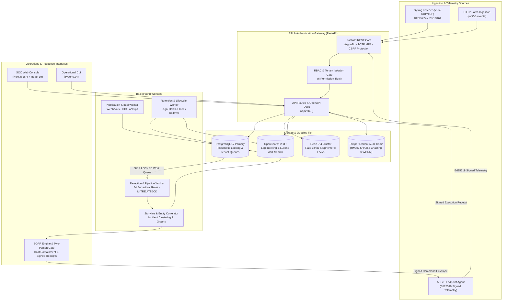

# AEGIS — Security Intelligence and Operations Platform

[](LICENSE)
[](pyproject.toml)
[](https://fastapi.tiangolo.com)
[](https://nextjs.org)
[](https://www.postgresql.org)
[](https://opensearch.org)
[](pyproject.toml)
[](https://astral.sh/ruff)
[](tests/)

> **AEGIS is an open-source, multi-tenant Security Information & Event Management (SIEM) and Security Orchestration, Automation, and Response (SOAR) platform featuring asymmetric cryptographic endpoint verification, multi-stage behavioral detection, and tamper-evident audit trails.**

---

## Table of Contents

1. [Project Identity](#1-project-identity)
2. [Project Overview](#2-project-overview)
3. [Feature Matrix](#3-feature-matrix)
4. [Architecture](#4-architecture)
5. [Technology Stack](#5-technology-stack)
6. [Repository Structure](#6-repository-structure)
7. [Prerequisites](#7-prerequisites)
8. [Installation and Local Development](#8-installation-and-local-development)
9. [Environment Variables](#9-environment-variables)
10. [Running the Application](#10-running-the-application)
11. [CLI Documentation](#11-cli-documentation)
12. [API Documentation](#12-api-documentation)
13. [Detection, Correlation & Threat Intelligence](#13-detection-correlation--threat-intelligence)
14. [User and Entity Behavior Analytics (UEBA)](#14-user-and-entity-behavior-analytics-ueba)
15. [SOAR & Endpoint Containment](#15-soar--endpoint-containment)
16. [Security Model](#16-security-model)
17. [Testing & Quality Assurance](#17-testing--quality-assurance)
18. [Deployment Profiles](#18-deployment-profiles)
19. [Known Limitations & Roadmap](#19-known-limitations--roadmap)
20. [Contributing](#20-contributing)
21. [Security Reporting](#21-security-reporting)
22. [License & Acknowledgements](#22-license--acknowledgements)
23. [Release Verification Summary](#23-release-verification-summary)

---

## 1. Project Identity

- **Platform Name:** AEGIS (Security Intelligence and Operations Platform)
- **One-Line Description:** A unified, tenant-isolated SIEM and SOAR platform engineered with Ed25519-signed endpoint telemetry, multi-stage detection correlation, and tamper-evident audit chains.
- **Problem Statement:** Modern enterprise Security Operations Centers (SOCs) struggle with brittle telemetry pipelines, desynchronized analytics stores, slow manual triage, and active response mechanisms that lack cryptographic endpoint attestation.
- **Intended Users:** Security operations engineers, detection engineers, SOC analysts, and incident responders seeking a transparent, self-hosted, and verifiable alternative to proprietary SIEM/SOAR monoliths.
- **Current Maturity:** **Developer Preview / Hardening in Progress.**
- **Important Limitations:** AEGIS is **NOT** currently certified as an enterprise appliance or autonomous containment agent. **Production-pilot qualification remains BLOCKED** pending live distributed cluster qualification (PostgreSQL 17, Redis 7, OpenSearch 2.11) and live Linux kernel namespace validation.

---

## 2. Project Overview

### The Security Operations Challenge
Traditional SOC architectures suffer from architectural fragmentation: log shippers forward raw telemetry into search lakes, disparate rule engines generate disconnected alerts, and external SOAR tools dispatch containment commands over unverified transport without cryptographic endpoint receipts.

### The AEGIS Workflow
1. **Durable Telemetry Ingestion:** RFC 5424/3164 Syslog (UDP/TCP), cloud audit logs, and endpoint agent events stream into the platform, guarded by bounded event payloads (64 KB) and pessimistic tenant queue capacity enforcement.
2. **Deterministic Detection & Correlation:** Workers evaluate 34 built-in behavioral detection rules across threshold, aggregation, ordered sequence, and periodicity primitives, mapping findings directly to MITRE ATT&CK techniques.
3. **Storyline Correlation & Entity Linking:** Related alerts converge into cohesive attack storylines with extracted entity graphs (hosts, users, IPs, hashes), eliminating duplicate incident notifications.
4. **Cryptographic SOAR Containment:** Responders initiate containment workflows governed by mandatory two-person human approval gates. Endpoint commands and execution receipts are signed via Ed25519 asymmetric key pairs with monotonic nonces and timestamp freshness checks.
5. **Tamper-Evident Auditing:** Every administrative, investigative, and automated state transition appends to an HMAC-SHA256 hash chain with external WORM / S3 Object Lock anchoring capabilities.

---

## 3. Feature Matrix

| Capability | Current Status | Relevant Module / Path | Verification Evidence / Current Limitations |
| :--- | :--- | :--- | :--- |
| **Multi-Tenant Ingestion** | **Implemented** | [`aegis/pipeline.py`](file:///d:/Project/Aegis/aegis/pipeline.py) | Verified under concurrency (`test_titan_phase3_security_hardening.py`). Serialized via `lock_tenant`. |
| **RFC Syslog Receiver** | **Implemented** | [`aegis/syslog.py`](file:///d:/Project/Aegis/aegis/syslog.py) | Octet counting & newline framing verified across UDP/TCP sockets (`test_syslog.py`). |
| **Behavioral Detection (34 Rules)** | **Implemented** | [`aegis/rules.py`](file:///d:/Project/Aegis/aegis/rules.py), [`aegis/detection.py`](file:///d:/Project/Aegis/aegis/detection.py) | Multi-stage, windowed state correlation verified in `test_detection.py`. |
| **Storyline Correlation** | **Implemented** | [`aegis/storylines.py`](file:///d:/Project/Aegis/aegis/storylines.py) | Entity graph clustering and timeline ordering verified in `test_storylines.py`. |
| **MITRE ATT&CK Mapping** | **Implemented** | [`aegis/rules.py`](file:///d:/Project/Aegis/aegis/rules.py) | 34 built-in rules mapped to T-codes; CLI inspection via `aegis mitre`. |
| **UEBA Risk Scoring** | **Implemented** | [`aegis/ueba.py`](file:///d:/Project/Aegis/aegis/ueba.py) | Bounded statistical baseline (14 days, >=20 obs); verified in `test_ueba.py`. Rule-based, not predictive ML. |
| **Threat Intelligence (IOCs)** | **Partially Implemented** | [`aegis/integrations.py`](file:///d:/Project/Aegis/aegis/integrations.py) | Local cache & mock provider verified; VirusTotal integration implemented but disabled by default. |
| **SOAR Approval Workflow** | **Implemented** | [`aegis/soar.py`](file:///d:/Project/Aegis/aegis/soar.py), [`aegis/response.py`](file:///d:/Project/Aegis/aegis/response.py) | Two-person rule enforced for destructive actions; verified in `test_soar.py`. |
| **Endpoint Containment (Agent)** | **Implemented / Hardened**| [`aegis/agent.py`](file:///d:/Project/Aegis/aegis/agent.py), [`aegis/endpoint_firewall.py`](file:///d:/Project/Aegis/aegis/endpoint_firewall.py)| Subprocess-mocked firewall isolation; live Linux network namespace execution pending. |
| **Agent Cryptography & Receipts** | **Implemented** | [`aegis/crypto.py`](file:///d:/Project/Aegis/aegis/crypto.py), [`aegis/api.py`](file:///d:/Project/Aegis/aegis/api.py) | Ed25519 signing, monotonic nonces, 300s window; key revocation races resolved in Phase 3. |
| **Tamper-Evident Audit Trail** | **Implemented** | [`aegis/security.py`](file:///d:/Project/Aegis/aegis/security.py) | HMAC-SHA256 sequential chain; external WORM/S3 Object Lock anchoring supported. |
| **Transport Encryption (TLS)** | **Implemented** | [`aegis/config.py`](file:///d:/Project/Aegis/aegis/config.py) | Production requires `sslmode=verify-full`, `sslrootcert`, `rediss://`, and HTTPS OpenSearch. |
| **SOC Console Web UI** | **Implemented** | `web/` (Next.js 16.4 / React 19) | 35 Vitest tests passed; verified against backend API contracts. |
| **Operational CLI** | **Implemented** | [`aegis/cli.py`](file:///d:/Project/Aegis/aegis/cli.py) | 36 operational subcommands verified via Typer runner. |

---

## 4. Architecture

AEGIS is partitioned into decoupled control, processing, and storage planes:



---

## 5. Technology Stack

### Backend Core
- **Language Runtime:** Python 3.12+ (tested through Python 3.14.3)
- **API Framework:** FastAPI 0.135.1, Starlette, Uvicorn 0.41.0
- **Settings Management:** Pydantic v2 / Pydantic-Settings 2.14.2
- **Database & ORM:** PostgreSQL 17 / SQLAlchemy 2.0.48 / Psycopg 3.3.3
- **Schema Migrations:** Alembic 1.18.4
- **Search & Analytics:** OpenSearch 2.11+ / `opensearch-py` 3.1.0
- **Distributed Cache & Locking:** Redis 7.4+ / `redis-py` 7.3.0
- **Cryptography:** `cryptography` 44.0+, `argon2-cffi` 25.1.0, `pyotp` 2.9.0
- **CLI Framework:** Typer 0.24.1, Click, Rich 14.3.3
- **Observability:** Prometheus Client 0.24.1, structured standard-library logging

### Frontend Web Console
- **Framework:** Next.js 16.4.0 (App Router, Turbopack)
- **UI Library:** React 19.2.4, React DOM 19.2.4
- **State & Data Fetching:** TanStack React Query 5.90.21
- **Styling:** Tailwind CSS 4.2.1
- **Icons & Visuals:** Lucide React 0.577.0, Recharts 3.8.0
- **Testing:** Vitest 4.1.11, Testing Library (React 16.3.2 / Jest-DOM 6.9.1)

---

## 6. Repository Structure

```
AEGIS/
├── aegis/                          # Core Platform Package
│   ├── agent.py                    # Endpoint agent daemon, signed dispatch, and containment
│   ├── ai.py                       # Grounded AI investigation advisor and prompt defense
│   ├── api.py                      # FastAPI REST routes, auth, rate-limiting, and receipts
│   ├── audit_anchor.py             # S3 Object Lock and local WORM audit anchoring
│   ├── cli.py                      # Typer operational CLI subcommands
│   ├── collector.py                # RFC Syslog listener (UDP/TCP framing)
│   ├── config.py                   # Pydantic Settings, environment validation, and TLS policies
│   ├── containment.py              # Containment state machine and receipt outcome semantics
│   ├── crypto.py                   # Ed25519 signing, verification, and key management
│   ├── db.py                       # SQLAlchemy models, tables, indexes, and session makers
│   ├── db_safety.py                # Database safety validator (prevents ambient target overrides)
│   ├── detection.py                # Behavioral detection engine and sliding window evaluator
│   ├── endpoint_firewall.py        # Safe OS firewall execution (Windows netsh / Linux iptables)
│   ├── integrations.py             # Webhook dispatcher, SSRF guards, and threat intel
│   ├── investigation.py            # Case management and timeline reconstruction
│   ├── notification_worker.py      # Background worker for alert webhooks and IOC lookups
│   ├── parsers.py                  # Syslog, Linux auth, web access, and cloud log parsers
│   ├── pipeline.py                 # Ingestion pipeline, batching, and tenant capacity control
│   ├── response.py                 # Legacy response router and playbook dispatch
│   ├── retention.py                # Retention lifecycle, legal holds, and index pruning
│   ├── rules.py                    # 34 behavioral detection rules and MITRE mappings
│   ├── schemas.py                  # Pydantic request/response DTOs and validation schemas
│   ├── security.py                 # Argon2id, TOTP MFA, RBAC, HMAC audit chaining, SSRF guard
│   ├── soar.py                     # Versioned SOAR playbook engine and two-person approval gates
│   ├── storylines.py               # Attack storyline correlation and entity graphs
│   ├── syslog.py                   # High-throughput RFC 5424/3164 Syslog socket receiver
│   ├── ueba.py                     # User & Entity Behavior Analytics baseline engine
│   └── worker.py                   # Detection pipeline worker and queue consumer
├── compose.yaml                    # Base Docker Compose service topology
├── compose.production.yaml         # Production Compose overlay (verified TLS & CA bindings)
├── docs/                           # Technical documentation, runbooks, and validation reports
│   └── validation/                 # Structured engineering qualification reports
│       └── project-titan-phase3/   # Phase 3 audit reports, concurrency matrices, and releases
├── migrations/                     # Alembic database migrations (0001 through 0010)
├── scripts/                        # Operational, benchmarking, and development utilities
│   ├── configure.py                # Zero-leak credential and secret generator
│   ├── dev.py                      # Local multi-process development orchestration
│   ├── initialize.py               # Database bootstrap and demo data seeder
│   └── integration_gate.py         # Release gate verifying PostgreSQL integration
├── tests/                          # Automated backend test suite (506 tests)
│   ├── test_titan_phase3_security_hardening.py # Phase 3 regressions (H-001 through H-004)
│   ├── test_endpoint_containment.py            # Containment semantics & firewall safety
│   ├── test_ironclad_qualification.py          # Cryptographic agent & replay qualification
│   └── ...                                     # Multi-tenant, UEBA, SOAR, and pipeline suites
└── web/                            # Next.js 16.4 SOC Web Console
    ├── app/                        # Next.js App Router pages and layouts
    ├── components/                 # Reusable UI component library
    └── tests/                      # Frontend Vitest test suite (35 tests)
```

---

## 7. Prerequisites

Before installing AEGIS, ensure your host environment satisfies the verified minimum software requirements:

- **Operating System:** Linux (Ubuntu 22.04+ / Debian 12+), macOS (13+), or Windows 11 / Windows Server 2022.
- **Python:** Version `3.12.0` or higher (verified through `3.14.3`).
- **Node.js:** Version `18.18.0` or higher (tested with Node `22.x` and Next.js `16.4.0`).
- **Package Manager:** `pip` (Python) and `npm` (Node.js).
- **Docker & Docker Compose (Optional for local dev, mandatory for full stack):** Docker Engine `24.0+`, Docker Compose `v2.20+`.
- **OpenSSL / Cryptography Support:** Modern OpenSSL library supporting Ed25519 and SHA-256 primitives.

---

## 8. Installation and Local Development

### Step 1: Clone the Repository
```bash
git clone https://github.com/aaryx/AEGIS.git
cd AEGIS
```

### Step 2: Configure Python Virtual Environment
**On Linux / macOS:**
```bash
python3 -m venv .venv
source .venv/bin/activate
pip install --upgrade pip
pip install -e ".[dev]"
```

**On Windows (PowerShell):**
```powershell
python -m venv .venv
.venv\Scripts\Activate.ps1
pip install --upgrade pip
pip install -e ".[dev]"
```

### Step 3: Configure Environment Secrets
Generate local random deployment secrets without leaking them to shell history:
```bash
python scripts/configure.py
```
This generates a local `.env` file with `ENVIRONMENT=development`, strong random audit secrets, and administrative database credentials.

### Step 4: Install Frontend Dependencies
```bash
cd web
npm install
cd ..
```

### Step 5: Initialize Database & Run Migrations
For local development, SQLite is used by default:
```bash
alembic upgrade head
python scripts/initialize.py
```
*Note: `scripts/initialize.py` seeds initial demo organizations, users, and MITRE detection rules.*

---

## 9. Environment Variables

| Variable Name | Purpose | Required / Optional | Safe Development Default | Production Requirement & Notes |
| :--- | :--- | :--- | :--- | :--- |
| `ENVIRONMENT` | Runtime environment profile | Optional | `development` | Must be `production` in live deployments. |
| `DATABASE_URL` | Primary relational database connection URI | Required | `sqlite:///./aegis.db` | Production requires `postgresql+psycopg://` with `sslmode=verify-full` and `sslrootcert`. |
| `REDIS_URL` | Distributed cache and queue connection URI | Optional (Dev) / Required (Prod) | `None` (in-memory fallback) | Production requires `rediss://` with authentication and valid TLS certificates. |
| `REDIS_CA` | Path to custom Redis root CA certificate | Optional | `None` | Used when Redis uses a private enterprise CA bundle. |
| `OPENSEARCH_URL` | OpenSearch analytics cluster endpoint | Optional (Dev) / Required (Prod) | `None` (LocalStorage fallback) | Production requires `https://` with valid hostname. |
| `OPENSEARCH_CA` | Path to OpenSearch trusted root CA certificate | Required if OpenSearch enabled | `None` | Production strictly fails closed if `opensearch_ca` is missing. |
| `OPENSEARCH_USERNAME`| OpenSearch basic auth username | Optional | `aegis` | Configured per OpenSearch internal security plugin. |
| `OPENSEARCH_PASSWORD`| OpenSearch basic auth password | Optional | `""` | Keep secret; minimum 16 characters in production. |
| `AUDIT_SECRET` | HMAC-SHA256 secret key for tamper-evident logs | Required | Auto-generated by `configure.py` | Must contain at least 32 characters in production. |
| `COOKIE_SECURE` | Enforces `Secure` flag on HTTP session cookies | Optional (Dev) / Required (Prod) | `false` | Must be `true` in production; requires HTTPS. |
| `PUBLIC_ORIGIN` | Publicly exposed web URL for CORS and CSRF | Required | `http://localhost:3000` | Must start with `https://` in production. |
| `SESSION_HOURS` | User session token expiration duration | Optional | `8` | Bounded between 1 and 24 hours. |
| `QUEUE_CAPACITY` | Max pending/retry event queue backlog per tenant | Optional | `100000` | Minimum 100; enforces tenant backpressure. |
| `MAX_EVENT_BYTES` | Maximum allowable raw event size | Optional | `65536` (64 KB) | Bounded between 1 KB and 256 KB to prevent memory exhaustion. |
| `AI_PROVIDER` | AI Copilot backend (`local`, `openai`, `azure`) | Optional | `local` | `openai`/`azure` requires HTTPS endpoint and `AI_API_KEY`. |

---

## 10. Running the Application

### 1. Start the Backend REST API
```bash
uvicorn aegis.api:create_app --factory --host 0.0.0.0 --port 8000 --reload
```
- API Base: `http://localhost:8000/api/v1`
- Interactive OpenAPI Docs: `http://localhost:8000/docs`
- Health Endpoint: `http://localhost:8000/health`

### 2. Start the Frontend SOC Console
```bash
cd web
npm run dev
```
Console is accessible at `http://localhost:3000`.

### 3. Start Background Workers
In separate terminal sessions or process supervisors:
- **Detection & Correlation Worker:**
  ```bash
  python -m aegis.worker
  ```
- **Notification & Threat Intelligence Worker:**
  ```bash
  python -m aegis.notification_worker
  ```
- **Lifecycle & Retention Worker:**
  ```bash
  python -m aegis.retention
  ```

### 4. Start RFC Syslog Listener
```bash
aegis ingest syslog --listen 127.0.0.1:5514
```

### 5. Running the Complete Stack with Docker Compose
For containerized testing:
```bash
docker compose up -d
```
To run the production overlay (requires TLS certificates mounted):
```bash
docker compose -f compose.yaml -f compose.production.yaml up -d
```

---

## 11. CLI Documentation

AEGIS provides an operational command-line utility built on Typer:

### Syntax Overview
```bash
aegis [GLOBAL-OPTIONS] COMMAND [ARGS]...
```
*Global options include `--format [table|json|csv]`, `--url <API_URL>`, and `--verbose`.*

### Discovered Command Reference

| Command | Purpose | Example Usage |
| :--- | :--- | :--- |
| `aegis health` | Inspect health of all platform components | `aegis health` |
| `aegis login` | Authenticate against API and acquire session | `aegis login --username admin` |
| `aegis bootstrap` | Create initial administrator with direct DB access | `aegis bootstrap --username admin --role SUPER_ADMIN` |
| `aegis rules` | List, inspect, and toggle behavioral detection rules | `aegis rules list` |
| `aegis alerts` | Triage, acknowledge, and resolve security alerts | `aegis alerts list --status OPEN` |
| `aegis incidents`| Manage aggregated multi-stage incidents | `aegis incidents list --severity critical` |
| `aegis storylines`| Correlate and inspect attack storylines and graph | `aegis storylines list` |
| `aegis ingest` | Ingest events from JSON files, directories, or Syslog | `aegis ingest file demo-data/brute-force.json` |
| `aegis soar` | View playbooks, approve executions, inspect status | `aegis soar executions` |
| `aegis agent` | Manage endpoint agents, enrollment, and daemon | `aegis agent run --server-url http://localhost:8000` |
| `aegis iocs` | Query and manage IOC indicators and matches | `aegis iocs query 198.51.100.24` |
| `aegis ueba` | Inspect user/host baseline deviations and risk | `aegis ueba users --min-score 50` |
| `aegis audit` | Verify cryptographic HMAC integrity of audit logs | `aegis audit verify` |
| `aegis mitre` | View coverage map against MITRE ATT&CK matrix | `aegis mitre matrix` |
| `aegis simulate`| Replay synthetic attack drills against detection engine | `aegis simulate brute-force` |

---

## 12. API Documentation

AEGIS exposes a tenant-isolated REST API versioned under `/api/v1`:

- **Interactive Documentation:** Available in development at `/docs` (Swagger UI) and `/redoc` (ReDoc).
- **Authentication Expectations:**
  - **Browser Sessions:** Cookie-based (`aegis_session`), requiring `X-CSRF-Token` header on state-changing operations (`POST`, `PUT`, `DELETE`, `PATCH`).
  - **API Clients & CLI:** Bearer tokens passed via `Authorization: Bearer <API_KEY_OR_TOKEN>`.
  - **Endpoint Agents:** Registered Ed25519 asymmetric identity tokens with mandatory HMAC/Ed25519 payload signatures.
- **Operational Boundaries:**
  - Default rate limit: 30 requests per minute per IP / client token.
  - Request body limit: 2 MB maximum (`max_request_bytes`).
  - Event payload limit: 64 KB maximum per event (`max_event_bytes`).

---

## 13. Detection, Correlation & Threat Intelligence

### Detection Architecture
AEGIS ships with **34 built-in behavioral detection rules** mapped to MITRE ATT&CK techniques:
- **Rule Primitives:** Simple thresholding, grouped distinct aggregations (e.g., distinct accounts targeted from one IP), ordered temporal sequences, and baseline anomaly detection.
- **Durable Windows:** State is tracked in PostgreSQL `window_states` tables, evaluated iteratively by background workers claiming jobs via `FOR UPDATE SKIP LOCKED`.

### Storyline Correlation & Entity Graph
Alerts sharing common entities (hosts, usernames, internal IP addresses) within configurable time windows are correlated into cohesive **Attack Storylines**. The correlation engine computes entity link graphs, reconstructing adversary lateral movement across the fleet.

### Threat Intelligence (IOCs)
- Normalized indicators: IPv4, IPv6, SHA-256, MD5, domain, and URL.
- Local high-speed cache with configurable TTL (default: 3,600 seconds).
- Optional VirusTotal provider (disabled by default, requires operator API key).
- External lookups enforce strict outbound SSRF defense, disallowing internal RFC 1918 subnets, loopbacks, and cloud metadata addresses (`169.254.169.254`).

---

## 14. User and Entity Behavior Analytics (UEBA)

The UEBA engine detects stealthy credential abuse and insider threats:
- **Baseline Requirements:** Requires a minimum observation window (default: 14 days, minimum 20 observations across 7 active days) before computing anomalies, preventing false positives during cold starts.
- **Implemented Detectors:**
  1. Anomalous authentication hours relative to user baseline.
  2. Geographic velocity and impossible travel anomalies.
  3. Excessive failed authentications preceding successful login.
  4. Sudden privilege escalation spikes.
- **Scoring:** Computes a normalized risk score (0 to 100).
- **Operational Limitation:** The UEBA engine uses bounded statistical baseline algorithms; it does not claim generative or predictive machine learning capabilities.

---

## 15. SOAR & Endpoint Containment

### Playbook Execution & Human-in-the-Loop
AEGIS enforces strict boundaries around automated response:
- **Two-Person Approval Gate:** Destructive actions (e.g., `isolate_host`, `terminate_process`, `quarantine_file`) cannot be executed by the initiating analyst alone. Approval is required from an independent user holding `SOC_MANAGER` or `SUPER_ADMIN` privileges.
- **Simulation Mode:** Operators can run playbooks in dry-run/simulation mode to verify action logic without modifying endpoint states.

### Endpoint Agent Security & Containment
- **Asymmetric Attestation:** Agents enroll using unique enrollment tokens and register Ed25519 public keys.
- **Signed Dispatch & Nonce Defense:** The AEGIS controller signs command envelopes using its private key. The agent verifies controller signatures, evaluates timestamp freshness (300-second window), and rejects replayed nonces.
- **Firewall Isolation:** Containment applies host firewall rules (Windows `netsh advfirewall` and Linux `iptables`) that drop inbound and outbound traffic while strictly preserving loopback and control-plane communication with the AEGIS controller IP. Global firewall flushes are strictly prohibited.
- **Signed Execution Receipts:** Following action execution, the agent signs an Ed25519 execution receipt containing the execution ID, status, and output. The controller verifies the receipt signature and commits the result to the tamper-evident audit log.

---

## 16. Security Model

| Security Dimension | Implemented Defensive Control |
| :--- | :--- |
| **Authentication** | Argon2id password hashing with dummy-hash timing-safe fallback; RFC 6238 TOTP MFA; 15-minute account lockouts after 5 failed attempts. |
| **Authorization** | Strict RBAC with 6 permission tiers (`VIEWER`, `ANALYST`, `SENIOR_ANALYST`, `SOC_MANAGER`, `SECURITY_ADMIN`, `SUPER_ADMIN`). |
| **Tenant Isolation** | Multi-tenant organization scoping enforced on all database queries; row-level isolation; pessimistic tenant locking (`lock_tenant`). |
| **Agent Key Handling** | Ed25519 asymmetric cryptography; monotonic nonces; key rotation with audit trail; atomic in-flight command cancellation upon revocation. |
| **Audit Integrity** | Append-only HMAC-SHA256 hash chain over `(previous_hash, timestamp, actor, action, tenant)`. Supports WORM and S3 Object Lock anchoring. *(Note: An HMAC chain does not prevent log deletion if an attacker possesses both database write access and the server's HMAC secret; external WORM anchoring is required for regulatory compliance).* |
| **Transport Security** | Production configurations fail closed if PostgreSQL, Redis, or OpenSearch connections lack verified TLS and trusted CA validation. |
| **Network Boundaries** | Outbound webhooks enforce SSRF guards blocking RFC 1918 subnets, loopbacks, and cloud metadata endpoints. |

---

## 17. Testing & Quality Assurance

AEGIS maintains a rigorous testing methodology combining unit, regression, concurrency, adversarial, and static analysis gates.

### Test Execution Commands & Verified Results

```bash
# 1. Run full backend test suite
pytest tests -q
# Result: 506 passed, 27 skipped in ~230s

# 2. Run dedicated Phase 3 security hardening suite
pytest tests/test_titan_phase3_security_hardening.py -q
# Result: 11 passed in 4.7s

# 3. Run endpoint containment and firewall suite
pytest tests/test_endpoint_containment.py -q
# Result: 35 passed in 14.4s

# 4. Run frontend Vitest suite
npm --prefix web test -- --run
# Result: 35 passed across 8 test files in 4.3s

# 5. Compile frontend production bundle
npm --prefix web run build
# Result: Compiled successfully; static optimization passed

# 6. Run static type checking (Mypy)
mypy aegis --ignore-missing-imports
# Result: Success: no issues found in 41 source files

# 7. Run code style & linting (Ruff)
ruff check aegis tests
# Result: All checks passed!

# 8. Run static security analysis (Bandit)
bandit -r aegis -ll -q
# Result: 0 High, 0 Medium vulnerabilities detected
```

---

## 18. Deployment Profiles

### Development Profile
- Intended for local feature development, testing, and UI validation.
- Database: Local SQLite file (`aegis.db`) with WAL mode.
- Cache & Search: In-memory queues and local storage fallback.
- Security: TLS requirements relaxed for `localhost`.

### Staging Profile
- Intended for end-to-end integration and load testing.
- Topology: Docker Compose with standalone PostgreSQL 17, Redis 7.4, and OpenSearch 2.11 containers.
- Execution: `docker compose up -d`.

### Production Profile (Overlay)
- Intended for hardened enterprise deployment.
- Topology: Managed PostgreSQL 17 cluster, Redis 7 cluster, OpenSearch 2.11 cluster.
- Security Requirements:
  - `ENVIRONMENT=production`
  - `COOKIE_SECURE=true`
  - `PUBLIC_ORIGIN=https://...`
  - `DATABASE_URL`: Must specify `sslmode=verify-full` and `sslrootcert`.
  - `REDIS_URL`: Must specify `rediss://` with authentication and required certificate verification.
  - `OPENSEARCH_URL`: Must specify `https://` and valid `OPENSEARCH_CA`.
- Deployment Command:
  ```bash
  docker compose -f compose.yaml -f compose.production.yaml up -d
  ```
- **Qualification State:** **BLOCKED** pending physical multi-node infrastructure verification.

---

## 19. Known Limitations & Roadmap

### Current Limitations
1. **SQLite Concurrency in Dev:** SQLite locks the entire database file during writes, limiting local development ingestion concurrency to single-worker processes. PostgreSQL is required for multi-worker scaling.
2. **Syslog UDP Framing:** UDP Syslog packets may be dropped under extreme network saturation. TCP Syslog with octet framing is recommended for production ingestion.
3. **Hardware-Dependent Containment:** Endpoint firewall scripts currently require elevated administrative privileges (`Administrator` on Windows, `CAP_NET_ADMIN` / `root` on Linux).
4. **Live Infrastructure Gate:** Automated tests currently skip 27 live tests when physical PostgreSQL/Redis/OpenSearch daemons are offline.

### Roadmap
- [ ] **v1.1:** eBPF-based lightweight Linux kernel telemetry probe for process execution and network connect events.
- [ ] **v1.2:** Native Sigma rule format compiler and bidirectional Sigma synchronization.
- [ ] **v1.3:** Automated STIX/TAXII 2.1 threat intelligence feed subscription daemon.
- [ ] **v1.4:** Distributed worker clustering via Celery / Temporal for horizontal scaling beyond 50,000 EPS.
- [ ] **v1.5:** macOS endpoint containment provider via `pfctl` anchor rules.

---

## 20. Contributing

We welcome contributions, bug reports, and detection rules from the security community:
1. **Fork and Branch:** Create a feature branch matching `feature/<name>` or `fix/<name>`.
2. **Coding Standards:** Format code using `ruff` (110 character line limit) and verify typing with `mypy`.
3. **Testing:** All pull requests must include unit and regression tests.
4. **Security Sensitive Code:** Any modifications to `aegis/security.py`, `aegis/crypto.py`, or `aegis/endpoint_firewall.py` require architectural review and threat modeling.

---

## 21. Security Reporting

If you discover a security vulnerability or bypass in AEGIS, please report it privately:

- **Email:** `aaryansingh24082005@gmail.com`
- **Guidelines:** Include a detailed technical description and reproducible proof of concept. Please allow up to 48 hours for acknowledgment prior to coordinated public disclosure.
- **Do NOT** open public GitHub issues for undisclosed security vulnerabilities.

---

## 22. License & Acknowledgements

- **License:** Distributed under the **MIT License**. See [LICENSE](LICENSE) for the full text.
- **Copyright:** (c) 2026 Aaryan Singh. All rights reserved.
- **Acknowledgements:** Built with inspiration from open-source security engineering communities, the MITRE ATT&CK framework, and Sigma detection standards.

---

## 23. Release Verification Summary

- **Release Target:** TITAN Phase 3 Hardening Release
- **Git Branch:** `feature/ironclad-qualification`
- **Initial HEAD:** `33a5ea90a964e206fa63326322e46d296ae2efb1`
- **Backend Quality:** 506 passed, 27 skipped, 0 failed across full Pytest suite.
- **Frontend Quality:** 35 passed across Vitest suite; Next.js 16.4 production build passed.
- **Static Verification:** 0 Mypy errors (41 files), 0 Ruff lint errors, 0 Bandit High/Medium issues.
- **Production Pilot Status:** **BLOCKED** pending live distributed cluster qualification.
