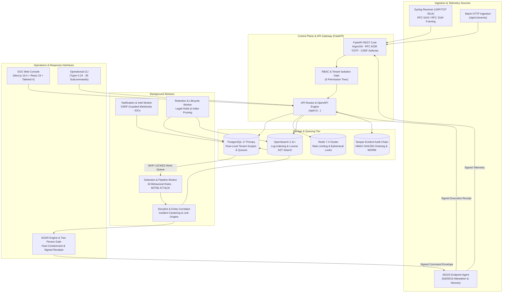

# AEGIS — Security Intelligence & Operations Platform

[](LICENSE)
[-brightgreen.svg)](https://github.com/aaryx/AEGIS/actions)
[](pyproject.toml)
[](https://fastapi.tiangolo.com)
[](https://nextjs.org)
[](https://www.postgresql.org)
[](https://opensearch.org)
[](https://redis.io)
[](pyproject.toml)
[](https://astral.sh/ruff)
[](tests/)
[](web/tests/)
[-brightgreen.svg)](.gitleaks.toml)

> **AEGIS is an open-source, multi-tenant Security Information and Event Management (SIEM) and Security Orchestration, Automation, and Response (SOAR) platform engineered with Ed25519 cryptographic endpoint attestation, multi-stage behavioral detection, automated attack storyline correlation, and tamper-evident audit trails.**

---

## Table of Contents

1. [Project Overview](#1-project-overview)
2. [Key Features](#2-key-features)
3. [Architecture Diagram](#3-architecture-diagram)
4. [How AEGIS Works](#4-how-aegis-works)
5. [Technology Stack](#5-technology-stack)
6. [Feature Status Matrix](#6-feature-status-matrix)
7. [Repository Structure](#7-repository-structure)
8. [Prerequisites and Installation](#8-prerequisites-and-installation)
9. [Environment Configuration](#9-environment-configuration)
10. [Running AEGIS](#10-running-aegis)
11. [Usage Examples and Workflows](#11-usage-examples-and-workflows)
12. [Testing and Quality Assurance](#12-testing-and-quality-assurance)
13. [Security Architecture](#13-security-architecture)
14. [Deployment Profiles](#14-deployment-profiles)
15. [Validation Status and Known Limitations](#15-validation-status-and-known-limitations)
16. [Roadmap](#16-roadmap)
17. [Contributing and Security Reporting](#17-contributing-and-security-reporting)
18. [License and Acknowledgements](#18-license-and-acknowledgements)

---

## 1. Project Overview

### Problem Statement
Modern Security Operations Centers (SOCs) face critical operational friction:
- **Telemetry Incoherence:** High-volume log shippers forward unvalidated raw events into disconnected data lakes without schema contracts or backpressure control.
- **Alert Fatigue & Disconnection:** Legacy SIEM rule engines generate isolated, noisy alerts that lack context, forcing analysts to manually correlate events across disparate hosts, users, and IP addresses.
- **Unverified Active Response:** Traditional SOAR platforms dispatch automated containment commands over plaintext or shared-secret channels without cryptographic attestation, nonces, or verifiable execution receipts.
- **Audit Fragility:** Investigative actions, alert suppressions, and containment decisions are logged in mutable tables vulnerable to tampering during compromise.

### The AEGIS Purpose & Differentiators
AEGIS addresses these operational and security gaps through an integrated, defense-in-depth architecture:
- **Cryptographic Endpoint Attestation:** Every endpoint command and telemetry batch is bound to Ed25519 keypairs with monotonic nonces, freshness windows, and signed execution receipts.
- **Multi-Stage Behavioral Detection:** 34 built-in rules evaluate sliding-window thresholding, grouped distinct aggregations, and ordered sequence progressions mapped to MITRE ATT&CK techniques.
- **Automated Storyline Correlation:** Alerts sharing entity indicators (hosts, usernames, internal IPs) are automatically clustered into cohesive attack storylines with visual entity link graphs.
- **Human-in-the-Loop SOAR Governance:** Destructive remediation actions enforce mandatory two-person authorization (`SOC_MANAGER` or `SUPER_ADMIN`), simulation dry-runs, and host-isolation firewall policies that strictly preserve controller connectivity.
- **Cryptographic Audit Hash-Chaining:** Every state transition appends to an HMAC-SHA256 sequential hash chain with external WORM (Write Once, Read Many) / S3 Object Lock anchoring support.

### Target Users
- **SOC Analysts & Incident Responders:** Requiring aggregated attack storylines, contextual entity graphs, and grounded AI-assisted investigation summaries.
- **Detection Engineers:** Authoring deterministic, multi-stage detection rules mapped to MITRE ATT&CK with sliding window state evaluation.
- **DevSecOps & Platform Engineers:** Operating self-hosted, tenant-isolated security infrastructure with strict TLS and verifiable cryptographic auditability.

---

## 2. Key Features

### 1. Ingestion & Telemetry Processing
- **RFC Syslog Receiver:** High-performance UDP and TCP socket collector supporting RFC 5424 structured syslog and RFC 3164 BSD syslog with octet-counting and newline framing.
- **Tenant Backpressure Control:** Pessimistic locking (`lock_tenant`) enforces hard queue capacity limits (`QUEUE_CAPACITY`, default: 100,000) and bounds individual raw event payloads (64 KB maximum) to prevent denial-of-service and memory exhaustion.
- **Resilient Outbox & Durability:** Work items are claimed using PostgreSQL `FOR UPDATE SKIP LOCKED`, preventing duplicate worker consumption and surviving abrupt process termination.

### 2. Behavioral Detection & MITRE ATT&CK Mapping
- **34 Built-in Detection Rules:** Curated across credential access, privilege escalation, persistence, defense evasion, execution, and exfiltration.
- **Evaluation Primitives:**
  - *Threshold:* Alert on $N$ occurrences within window $W$ (e.g., repeated authentication failures).
  - *Aggregation:* Alert on distinct values across grouping fields (e.g., password spraying across distinct accounts).
  - *Sequence:* Ordered multi-step patterns (e.g., multiple authentication failures immediately followed by successful logon).
  - *Periodicity / Anomaly:* Deviation from baseline event frequencies.
- **Sliding Window State Tracking:** Durable window evaluation stored in relational schemas, resisting clock skew and application restarts.

### 3. Attack Storyline Correlation & Entity Graphs
- **Incident Clustering:** Evaluates temporal proximity (default: 30-minute window) and shared entity pivots (hostnames, usernames, IP addresses, file hashes).
- **Lateral Movement Tracking:** Automatically links disparate alert stages into single investigatory storylines, eliminating redundant notification storms.
- **Entity Link Graphs:** Computes bi-directional relationship graphs and chronological timelines for rapid triage.

### 4. Threat Intelligence (IOCs)
- **Multi-Type Indicator Matching:** Fast lookups for IPv4, IPv6, SHA-256, MD5, domain names, and URLs.
- **Local In-Memory Cache:** Configurable indicator cache (default TTL: 3,600s) for line-rate event enrichment.
- **SSRF-Guarded External Intelligence:** Outbound lookups enforce strict IP boundary validation, blocking loopback, private subnets (RFC 1918), and cloud metadata addresses (`169.254.169.254`).

### 5. User and Entity Behavior Analytics (UEBA)
- **Cold-Start Guarded Baselines:** Requires a minimum observation baseline (14 days, $\ge 20$ observations across 7 active days) before generating anomaly scores, preventing false positives during bootstrap.
- **Statistical Detectors:**
  - Bounded Median Absolute Deviation (MAD) activity volume spikes.
  - Unusual authentication hours relative to historical user distribution.
  - New source IP and new host access patterns.
  - Rapid failure-then-success sequence detection.
- **Risk Scoring:** Computes bounded risk scores (0 to 100) per user and entity.

### 6. SOAR & Endpoint Security
- **Versioned Playbooks:** Declarative YAML/JSON playbooks specifying trigger conditions, automated enrichment steps, and conditional containment.
- **Two-Person Approval Gate:** Destructive actions (`isolate_host`, `terminate_process`, `quarantine_file`) require secondary authorization from an independent SOC manager.
- **Asymmetric Attestation:** Endpoint daemons register Ed25519 public keys upon token-based enrollment.
- **Anti-Replay Nonce Invariant:** Commands are dispatched within a 300-second freshness window with strictly incrementing, non-reusable nonces.
- **Safe Host Firewall Isolation:** Platform-native firewall rules (Linux `iptables` and Windows `netsh advfirewall`) drop external lateral and egress traffic while strictly preserving loopback and communication with the AEGIS controller IP. Global firewall flushes are prohibited.
- **Signed Execution Receipts:** Agents return Ed25519-signed execution receipts containing execution status and output, cryptographically committed to the audit trail.

### 7. Cryptographic Audit Trail
- **HMAC-SHA256 Hash Chain:** Every sensitive operation appends an entry computing `HMAC-SHA256(secret, previous_hash + timestamp + actor + action + tenant)`.
- **WORM & S3 Object Lock Anchoring:** Periodic batch hashes are exported and anchored to immutable WORM storage or AWS S3 Object Lock buckets in compliance mode.

---

## 3. Architecture Diagram

The following Mermaid diagram illustrates the decoupled control, data, worker, ingestion, and operational planes:



---

## 4. How AEGIS Works

AEGIS executes an end-to-end event lifecycle from ingestion to audit anchoring:

```
[ Telemetry Ingestion ]
         │
         ▼
[ Normalization & Capacity Check ]
         │
         ▼
[ Durable Queue (PostgreSQL) ]
         │
         ▼
[ Behavioral Detection (34 Rules) ] ──► [ Alert Generation ]
         │                                       │
         ▼                                       ▼
[ UEBA Baseline Analytics ]             [ Storyline Correlation ]
         │                                       │
         ▼                                       ▼
[ Anomaly Risk Scoring ]                [ Aggregated Incident ]
                                                 │
                                                 ▼
                                        [ SOAR Playbook Trigger ]
                                                 │
                                                 ▼
                                        [ Two-Person Approval ]
                                                 │
                                                 ▼
                                        [ Signed Dispatch to Agent ]
                                                 │
                                                 ▼
                                        [ Safe Firewall Isolation ]
                                                 │
                                                 ▼
                                        [ Signed Execution Receipt ]
                                                 │
                                                 ▼
                                        [ HMAC-SHA256 Audit Anchor ]
```

### Stage 1: Ingestion & Validation
1. Telemetry arrives via UDP/TCP Syslog (port 5514), batch REST endpoints (`POST /api/v1/events`), or authenticated endpoint agent streams.
2. The ingestion pipeline enforces tenant payload boundaries (`MAX_EVENT_BYTES=65536`) and checks backlog capacity under a pessimistic tenant lock (`lock_tenant`). Over-capacity submissions are rejected with HTTP 429 backpressure.
3. Raw events are parsed, normalized into common schemas, and written durably to the PostgreSQL work queue.

### Stage 2: Detection & State Evaluation
1. Background workers claim pending event batches using `SELECT ... FOR UPDATE SKIP LOCKED`.
2. Normalized events are evaluated against 34 built-in detection rules. Sliding window state is tracked in the database to guarantee resilience across worker restarts.
3. Matching event sequences trigger security alerts tagged with MITRE ATT&CK technique IDs, severity ratings, and contextual metadata.

### Stage 3: Storyline Correlation & Investigation
1. The correlation worker evaluates new alerts against active storylines within the configured correlation window (default: 1,800 seconds).
2. Alerts matching existing entity pivots (host ID, username, IP address) are attached to existing storylines. Non-matching alerts instantiate new storylines.
3. The engine computes entity link graphs, mapping lateral movement and timeline progression.

### Stage 4: UEBA & Threat Intelligence Enrichment
1. In parallel, authentication and access events are ingested into the UEBA pipeline.
2. If the entity has satisfied the 14-day cold-start threshold, the engine evaluates Median Absolute Deviation (MAD) and distribution metrics, adjusting the entity risk score (0 to 100).
3. Indicators of Compromise (IOCs) are queried against the local high-speed cache and optional external feeds.

### Stage 5: Response, SOAR & Containment
1. Triggered alerts or storylines match versioned SOAR playbooks.
2. If a playbook specifies a destructive action (such as host isolation), an execution ticket is generated and placed into `PENDING_APPROVAL` status.
3. An authorized manager (`SOC_MANAGER` or `SUPER_ADMIN`) approves the action via the web console or CLI.
4. The controller creates an Ed25519-signed command envelope with a strictly monotonic nonce and timestamp.
5. The endpoint agent validates the signature, executes safe firewall isolation (preserving controller connectivity), and returns a signed receipt.

### Stage 6: Audit Anchoring
1. The execution outcome is validated by the controller and appended to the HMAC-SHA256 audit log chain.
2. Scheduled batch jobs anchor audit heads to local WORM storage or AWS S3 Object Lock.

---

## 5. Technology Stack

### Backend Platform Core
- **Language & Runtime:** Python 3.12+ (tested through Python 3.14.3)
- **Web API Framework:** FastAPI `0.135.1`, Starlette, Uvicorn `0.41.0`
- **Configuration & Validation:** Pydantic v2 / Pydantic-Settings `2.14.2`
- **Database & ORM:** PostgreSQL 17 / SQLAlchemy `2.0.48` / Psycopg 3 (`3.3.3`)
- **Schema Migrations:** Alembic `1.18.4` (11 managed migrations)
- **Search & Log Storage:** OpenSearch `2.11+` / `opensearch-py` `3.1.0`
- **Distributed Cache & State:** Redis `7.4+` / `redis-py` `7.3.0`
- **Cryptographic Primitives:** `cryptography` `>=43.0.0`, `argon2-cffi` `25.1.0`, `pyotp` `2.9.0`
- **CLI Framework:** Typer `0.24.1`, Click, Rich `14.3.3`
- **Metrics & Observability:** Prometheus Client `0.24.1`

### Frontend SOC Console
- **Framework:** Next.js `16.4.0` (App Router, Turbopack)
- **UI Architecture:** React `19.2.4`, React DOM `19.2.4`
- **State & Data Synchronization:** TanStack React Query `5.90.21`
- **Styling:** Tailwind CSS `4.2.1` with PostCSS
- **Visualizations & Icons:** Lucide React `0.577.0`, Recharts `3.8.0`
- **Testing Framework:** Vitest `4.1.11`, Testing Library React `16.3.2`, Jest-DOM `6.9.1`

### Quality Assurance & Security Tooling
- **Test Runners:** Pytest `9.0.3`, Pytest-Cov `7.0.0`, Playwright `1.58.2`
- **Static Analysis & Linting:** Mypy `1.19.1` (strict mode), Ruff `0.15.6`
- **Security Scanners:** Bandit `1.9.4`, Pip-Audit `2.10.0`, GitLeaks `v8.x`
- **Container Security & SBOM:** Trivy `0.35.0`, Anchore Syft CycloneDX

---

## 6. Feature Status Matrix

| Subsystem / Capability | Status Classification | Relevant Module | Verification & Operational Notes |
| :--- | :--- | :--- | :--- |
| **Multi-Tenant Ingestion** | **Implemented** | [`aegis/pipeline.py`](file:///d:/Project/Aegis/aegis/pipeline.py) | Verified under concurrency (`test_titan_phase3_security_hardening.py`). Enforces tenant queue capacity under pessimistic locking. |
| **RFC Syslog Receiver** | **Implemented** | [`aegis/syslog.py`](file:///d:/Project/Aegis/aegis/syslog.py) | Octet-counting and newline framing verified over UDP/TCP (`test_syslog.py`). |
| **Behavioral Detection (34 Rules)** | **Implemented** | [`aegis/rules.py`](file:///d:/Project/Aegis/aegis/rules.py), [`aegis/detection.py`](file:///d:/Project/Aegis/aegis/detection.py) | Threshold, aggregation, and sequence rules verified in `test_detection.py`. |
| **MITRE ATT&CK Mapping** | **Implemented** | [`aegis/rules.py`](file:///d:/Project/Aegis/aegis/rules.py) | All 34 rules tagged with T-codes; matrix queryable via `aegis mitre`. |
| **Attack Storyline Correlation** | **Implemented** | [`aegis/storylines.py`](file:///d:/Project/Aegis/aegis/storylines.py) | Temporal clustering and entity graphs verified in `test_storylines.py`. |
| **UEBA Risk Baselining** | **Implemented** | [`aegis/ueba.py`](file:///d:/Project/Aegis/aegis/ueba.py) | Bounded statistical MAD baseline (14-day observation window); verified in `test_ueba.py`. |
| **Threat Intelligence (IOCs)** | **Partially Implemented** | [`aegis/integrations.py`](file:///d:/Project/Aegis/aegis/integrations.py) | Local cache & mock provider verified; VirusTotal integration supported with operator API key. |
| **SOAR Approval Workflow** | **Implemented** | [`aegis/soar.py`](file:///d:/Project/Aegis/aegis/soar.py), [`aegis/response.py`](file:///d:/Project/Aegis/aegis/response.py) | Two-person approval gate strictly enforced for destructive actions (`test_soar.py`). |
| **Endpoint Agent Attestation** | **Implemented** | [`aegis/crypto.py`](file:///d:/Project/Aegis/aegis/crypto.py), [`aegis/api.py`](file:///d:/Project/Aegis/aegis/api.py) | Ed25519 signing, timestamp freshness, and monotonic nonces (`test_agent_nonce_replay_invariant.py`). |
| **Endpoint Firewall Isolation** | **Implemented / Hardened** | [`aegis/endpoint_firewall.py`](file:///d:/Project/Aegis/aegis/endpoint_firewall.py) | Subprocess execution verified (`test_endpoint_containment.py`). Drops external traffic while preserving controller IP. |
| **Live Kernel Namespace Containment** | **Simulated / Mocked** | [`aegis/agent.py`](file:///d:/Project/Aegis/aegis/agent.py) | Automated tests execute against subprocess mocks. Physical Linux network namespace isolation requires live host. |
| **Tamper-Evident Audit Trail** | **Implemented** | [`aegis/security.py`](file:///d:/Project/Aegis/aegis/security.py) | HMAC-SHA256 sequential hash chain with WORM/S3 Object Lock anchoring support. |
| **Transport TLS Verification** | **Implemented** | [`aegis/config.py`](file:///d:/Project/Aegis/aegis/config.py) | Production profile fails closed if PostgreSQL, Redis, or OpenSearch connections lack TLS/CA validation. |
| **SOC Web Console** | **Implemented** | `web/` (Next.js 16.4 / React 19) | 35 Vitest tests passed; verified against backend API contracts and containment flows. |
| **Operational CLI** | **Implemented** | [`aegis/cli.py`](file:///d:/Project/Aegis/aegis/cli.py) | 36 subcommands verified via Typer runner; supports table, JSON, and CSV output formats. |
| **Grounded AI Investigation** | **Implemented** | [`aegis/ai.py`](file:///d:/Project/Aegis/aegis/ai.py) | RAG-grounded prompt construction with delimiter escaping and prompt-injection defense. |
| **eBPF Kernel Telemetry Probe** | **Planned** | — | Scheduled for future release; not yet implemented. |
| **Sigma Rule Compiler** | **Planned** | — | Scheduled for future release; not yet implemented. |

---

## 7. Repository Structure

```
AEGIS/
├── aegis/                          # Core Platform Package
│   ├── agent.py                    # Endpoint agent daemon, signed dispatch, and containment
│   ├── ai.py                       # Grounded AI investigation advisor and prompt defense
│   ├── api.py                      # FastAPI REST routes, auth, rate-limiting, and receipts
│   ├── audit_anchor.py             # S3 Object Lock and local WORM audit anchoring
│   ├── cli.py                      # Typer operational CLI (36 subcommands)
│   ├── collector.py                # RFC Syslog listener (UDP/TCP framing)
│   ├── config.py                   # Pydantic Settings, environment validation, and TLS policies
│   ├── containment.py              # Containment state machine and receipt outcome semantics
│   ├── crypto.py                   # Ed25519 signing, verification, and key management
│   ├── db.py                       # SQLAlchemy models, tables, indexes, and session makers
│   ├── db_safety.py                # Database safety validator (rejects ambient target overrides)
│   ├── detection.py                # Behavioral detection engine and sliding window evaluator
│   ├── endpoint_firewall.py        # Safe OS firewall execution (Windows netsh / Linux iptables)
│   ├── integrations.py             # Webhook dispatcher, SSRF guards, and threat intel
│   ├── investigation.py            # Case management and timeline reconstruction
│   ├── notification_worker.py      # Background worker for alert webhooks and IOC lookups
│   ├── parsers.py                  # Syslog, Linux auth, web access, and cloud log parsers
│   ├── pipeline.py                 # Ingestion pipeline, batching, and tenant capacity control
│   ├── response.py                 # Legacy response router and playbook dispatch
│   ├── retention.py                # Retention lifecycle, legal holds, and index pruning
│   ├── rules.py                    # 34 behavioral detection rules and MITRE mappings
│   ├── schemas.py                  # Pydantic request/response DTOs and validation schemas
│   ├── security.py                 # Argon2id, TOTP MFA, RBAC, HMAC audit chaining, SSRF guard
│   ├── soar.py                     # Versioned SOAR playbook engine and two-person approval gates
│   ├── storylines.py               # Attack storyline correlation and entity graphs
│   ├── syslog.py                   # High-throughput RFC 5424/3164 Syslog socket receiver
│   ├── ueba.py                     # User & Entity Behavior Analytics baseline engine
│   └── worker.py                   # Detection pipeline worker and queue consumer
├── compose.yaml                    # Base Docker Compose service topology
├── compose.production.yaml         # Production Compose overlay (verified TLS & CA bindings)
├── docs/                           # Technical documentation, runbooks, and validation reports
│   └── validation/                 # Structured engineering qualification reports
│       ├── project-titan-phase3/   # Phase 3 audit reports, concurrency matrices, and releases
│       └── secret-scan-recovery/   # GitLeaks false-positive investigation & recovery report
├── migrations/                     # Alembic database migrations (0001 through 0011)
│   ├── versions/
│   │   ├── 0001_initial.py
│   │   ├── 0002_durable_jobs.py
│   │   ├── 0003_tenant_integrity.py
│   │   ├── 0004_evidence_integrity.py
│   │   ├── 0005_agent_identity_and_hardening.py
│   │   ├── 0006_immutable_audit_anchoring.py
│   │   ├── 0007_detection_replay_lab.py
│   │   ├── 0008_storylines.py
│   │   ├── 0009_soar.py
│   │   ├── 0010_intelligence.py
│   │   └── 0011_ueba.py
│   └── env.py
├── pyproject.toml                  # Python package configuration and tool metadata
├── requirements.lock               # Pinned Python dependency lockfile
├── scripts/                        # Operational, benchmarking, and development utilities
│   ├── acceptance.py               # End-to-end acceptance test runner
│   ├── benchmark_concurrency_and_stress.py # High-load pipeline stress suite
│   ├── configure.py                # Zero-leak credential and secret generator
│   ├── dev.py                      # Multi-process development orchestration utility
│   ├── e2e.py                      # Playwright browser end-to-end runner
│   ├── initialize.py               # Database bootstrap and demo data seeder
│   ├── integration_checks.py       # Live service health validator
│   ├── integration_gate.py         # Release gate verifying PostgreSQL integration
│   ├── recovery_drill.py           # Outage and durable outbox recovery simulator
│   └── verify_audit_anchors.py     # Independent HMAC audit-chain verifier
├── tests/                          # Automated backend test suite (533 tests total)
│   ├── test_titan_phase3_security_hardening.py # Phase 3 regressions (H-001 through H-004)
│   ├── test_endpoint_containment.py            # Containment semantics & firewall safety
│   ├── test_agent_nonce_replay_invariant.py    # Ed25519 nonce anti-replay invariant
│   ├── test_storylines.py                      # Storyline clustering & entity graph tests
│   ├── test_soar.py                            # SOAR approval gates & playbook executions
│   ├── test_ueba.py                            # Bounded statistical UEBA baseline tests
│   └── ...
└── web/                            # Next.js 16.4 SOC Web Console
    ├── app/                        # App Router pages, dashboards, and layouts
    ├── components/                 # Reusable UI component library
    ├── package.json                # Frontend dependencies and test scripts
    └── tests/                      # Frontend Vitest test suite (35 tests)
```

---

## 8. Prerequisites and Installation

### Host System Requirements
- **Operating System:** Linux (Ubuntu 22.04+ / Debian 12+), macOS (13+), or Windows 11 / Windows Server 2022.
- **Python:** Version `3.12.0` or higher (verified through `3.14.3`).
- **Node.js:** Version `18.18.0` or higher (tested with Node `22.x` and Next.js `16.4.0`).
- **Package Managers:** `pip` (Python) and `npm` (Node.js).
- **Docker & Compose (Optional for dev, required for full stack):** Docker Engine `24.0+`, Docker Compose `v2.20+`.

### Step-by-Step Installation

#### 1. Clone the Repository
```bash
git clone https://github.com/aaryx/AEGIS.git
cd AEGIS
```

#### 2. Configure Python Virtual Environment
**On Linux / macOS:**
```bash
python3 -m venv .venv
source .venv/bin/activate
pip install --upgrade pip
pip install -c requirements.lock -e ".[dev]"
```

**On Windows (PowerShell):**
```powershell
python -m venv .venv
.venv\Scripts\Activate.ps1
python -m pip install --upgrade pip
python -m pip install -c requirements.lock -e ".[dev]"
```

#### 3. Generate Local Development Secrets
Run the zero-leak secret generator to create a local `.env` file containing cryptographically strong random keys:
```bash
python scripts/configure.py
```
*This populates `ENVIRONMENT=development`, random audit HMAC secrets, session configuration, and local SQLite defaults.*

#### 4. Install Frontend Dependencies
```bash
cd web
npm ci
cd ..
```

#### 5. Initialize Database & Run Migrations
```bash
alembic upgrade head
python scripts/initialize.py
```
*Note: `initialize.py` applies initial migration state and seeds demo tenant organizations, administrative users, and MITRE detection rules.*

---

## 9. Environment Configuration

The following table details all primary configuration settings managed by [`aegis/config.py`](file:///d:/Project/Aegis/aegis/config.py):

| Variable Name | Purpose | Safe Dev Default | Production Requirement & Rules |
| :--- | :--- | :--- | :--- |
| `ENVIRONMENT` | Operating environment profile | `development` | Must be `production` in live environments. |
| `DATABASE_URL` | Relational database connection URI | `sqlite:///./aegis.db` | Production requires `postgresql+psycopg://` with `sslmode=verify-full` and `sslrootcert`. |
| `REDIS_URL` | Distributed cache and ephemeral lock URI | `None` (in-memory) | Production requires `rediss://` with authentication and valid TLS certificates. |
| `REDIS_CA` | Path to custom Redis root CA certificate | `None` | Required in production if using a private enterprise CA bundle. |
| `OPENSEARCH_URL` | OpenSearch log analytics endpoint | `None` (local storage) | Production requires `https://` with valid hostname. |
| `OPENSEARCH_CA` | Path to OpenSearch trusted root CA bundle | `None` | Production strictly fails closed if `OPENSEARCH_CA` is missing when search is enabled. |
| `OPENSEARCH_USERNAME` | OpenSearch HTTP basic auth username | `aegis` | Configured per OpenSearch internal security plugin. |
| `OPENSEARCH_PASSWORD` | OpenSearch HTTP basic auth password | `""` | Minimum 16 characters in production. Never commit plaintext passwords. |
| `AUDIT_SECRET` | Secret key for HMAC-SHA256 audit chaining | Generated by script | Must contain at least 32 characters in production. |
| `COOKIE_SECURE` | Enforces `Secure` flag on session cookies | `false` | Must be `true` in production; requires HTTPS. |
| `PUBLIC_ORIGIN` | Public web origin for CORS and CSRF | `http://localhost:3000` | Must specify `https://` in production. |
| `SESSION_HOURS` | User session token validity window | `8` | Bounded between 1 and 24 hours. |
| `QUEUE_CAPACITY` | Max pending/retry event backlog per tenant | `100000` | Enforces backpressure; minimum allowable value is 100. |
| `MAX_EVENT_BYTES` | Maximum allowable raw event payload size | `65536` (64 KB) | Bounded between 1 KB and 256 KB to prevent memory exhaustion. |
| `AI_PROVIDER` | AI Copilot backend (`local`, `openai`, `azure`) | `local` | Cloud providers require an HTTPS endpoint and `AI_API_KEY`. |

---

## 10. Running AEGIS

### 1. Launch Backend API Server
```bash
uvicorn aegis.api:create_app --factory --host 0.0.0.0 --port 8000 --reload
```
- API Base URL: `http://localhost:8000/api/v1`
- Interactive OpenAPI Swagger Docs: `http://localhost:8000/docs`
- Health Endpoint: `http://localhost:8000/health`

### 2. Launch Frontend SOC Console
```bash
cd web
npm run dev
```
Console is accessible at `http://localhost:3000`.

### 3. Launch Background Workers
In separate terminal sessions or system process supervisors:
- **Detection & Correlation Worker:**
  ```bash
  python -m aegis.worker
  ```
- **Notification & Threat Intelligence Worker:**
  ```bash
  python -m aegis.notification_worker
  ```
- **Lifecycle & Retention Worker:**
  ```bash
  python -m aegis.retention
  ```

### 4. Launch RFC Syslog Listener
```bash
aegis ingest syslog --listen 127.0.0.1:5514
```

### 5. Running the Complete Stack with Docker Compose
For containerized testing with PostgreSQL 17, Redis 7.4, and OpenSearch 2.11:
```bash
docker compose up -d --build
```
To run the hardened production overlay (requires TLS certificates mounted):
```bash
docker compose -f compose.yaml -f compose.production.yaml up -d
```

---

## 11. Usage Examples and Workflows

### 1. Operational CLI Workflows

AEGIS includes an operational CLI built on Typer with 36 subcommands:

```bash
# Check platform component health
aegis health

# Authenticate against API and acquire session token
aegis login --username admin

# List active behavioral detection rules
aegis rules list

# Inspect alert storylines and correlated entity graphs
aegis storylines list

# Triage open security alerts
aegis alerts list --status OPEN

# Replay synthetic attack drills against the detection pipeline
aegis simulate brute-force

# Verify cryptographic HMAC integrity of the audit log chain
aegis audit verify

# Inspect MITRE ATT&CK coverage matrix
aegis mitre matrix
```

### 2. Ingesting Events via REST API

Submit an event batch to the tenant-isolated API:

```bash
curl -X POST "http://localhost:8000/api/v1/events" \
  -H "Content-Type: application/json" \
  -H "Authorization: Bearer <API_TOKEN>" \
  -d '[
    {
      "source_type": "linux_auth",
      "event_category": "authentication",
      "action": "login",
      "outcome": "failure",
      "actor": "attacker",
      "target": "server01",
      "source_ip": "198.51.100.44",
      "timestamp": "2026-10-18T14:30:00Z",
      "details": {"reason": "invalid_password"}
    }
  ]'
```

### 3. SOAR Containment & Two-Person Approval

1. **Trigger Containment:** An alert prompts a playbook execution requesting host isolation:
   ```bash
   aegis soar execute --playbook-id "pb-isolate-host" --target "host-srv-01"
   # Output: Execution 8f1e2c4d placed in PENDING_APPROVAL status.
   ```
2. **Review & Approve:** An independent `SOC_MANAGER` inspects and approves the action:
   ```bash
   aegis soar approve 8f1e2c4d --rationale "Confirmed adversary lateral movement"
   # Output: Execution approved. Dispatched Ed25519-signed command envelope.
   ```
3. **Verify Receipt:** Query execution status and cryptographically signed receipt:
   ```bash
   aegis soar execution 8f1e2c4d
   # Output: Status COMPLETED. Receipt verified via agent public key.
   ```

---

## 12. Testing and Quality Assurance

AEGIS maintains a multi-tier testing methodology spanning unit, regression, concurrency, adversarial, and static analysis gates:

```bash
# 1. Run full backend test suite
pytest tests -q
# Result: 506 passed, 27 skipped (skipped require live external databases)

# 2. Run Phase 3 security hardening regression suite (H-001 through H-004)
pytest tests/test_titan_phase3_security_hardening.py -q
# Result: 11 passed in 4.7s

# 3. Run endpoint containment and firewall safety tests
pytest tests/test_endpoint_containment.py -q
# Result: 35 passed in 14.4s

# 4. Run frontend Vitest suite
npm --prefix web test -- --run
# Result: 35 passed across 8 test files in 5.3s

# 5. Compile frontend production bundle
npm --prefix web run build
# Result: Next.js production build compiled successfully

# 6. Run static type checking (Mypy)
mypy aegis --ignore-missing-imports
# Result: Success: no issues found in 41 source files

# 7. Run code style and linting (Ruff)
ruff check aegis tests
# Result: All checks passed!

# 8. Run static security vulnerability scan (Bandit)
bandit -r aegis -ll -q
# Result: 0 High, 0 Medium vulnerabilities detected

# 9. Run local secret scan (GitLeaks)
gitleaks detect --config=".gitleaks.toml" --redact -v
# Result: 0 leaks found across 33 commits
```

---

## 13. Security Architecture

| Security Dimension | Defensive Mechanism Implemented |
| :--- | :--- |
| **Authentication** | Argon2id password hashing with dummy-hash timing-safe fallback; RFC 6238 TOTP MFA; 15-minute account lockouts after 5 consecutive failed attempts. |
| **Authorization & RBAC** | Strict RBAC with 6 permission tiers (`VIEWER`, `ANALYST`, `SENIOR_ANALYST`, `SOC_MANAGER`, `SECURITY_ADMIN`, `SUPER_ADMIN`). |
| **Tenant Isolation** | Scoped queries; row-level isolation; pessimistic tenant locking (`lock_tenant`) preventing cross-tenant data leakage and noisy-neighbor exhaustion. |
| **Agent Cryptography** | Ed25519 asymmetric keypairs; strictly monotonic nonces; 300-second timestamp freshness; atomic in-flight command cancellation on agent revocation. |
| **Firewall Isolation Safety** | Host containment injects targeted drop rules (Windows `netsh`, Linux `iptables`) preserving loopback and controller IP connectivity. Global firewall flushes are prohibited. |
| **Audit Log Integrity** | Append-only HMAC-SHA256 hash chain over `(previous_hash, timestamp, actor, action, tenant)`. Supports WORM and AWS S3 Object Lock anchoring. |
| **Transport Security** | Production configurations fail closed if PostgreSQL, Redis, or OpenSearch connections lack verified TLS and trusted CA validation. |
| **Network Boundaries** | Outbound webhooks and threat intelligence integrations enforce SSRF guards blocking RFC 1918 subnets, loopbacks, and cloud metadata endpoints. |

---

## 14. Deployment Profiles

### Development Profile
- **Target:** Local feature development, rule testing, and UI validation.
- **Relational Storage:** SQLite database file (`aegis.db`) with WAL journal mode.
- **Cache & Search:** In-memory queue fallback and local search storage.
- **Security:** TLS requirements relaxed for `localhost` connections.

### Staging Profile
- **Target:** Integration testing, adversarial failure drills, and Playwright E2E runs.
- **Topology:** Docker Compose with standalone PostgreSQL 17, Redis 7.4, and OpenSearch 2.11 containers.
- **Execution Command:** `docker compose up -d`

### Production Profile (Overlay)
- **Target:** Hardened enterprise deployment.
- **Topology:** Dedicated multi-node PostgreSQL 17 cluster, Redis 7.4 cluster, OpenSearch 2.11 cluster.
- **Mandatory Configuration Requirements:**
  - `ENVIRONMENT=production`
  - `COOKIE_SECURE=true`
  - `PUBLIC_ORIGIN=https://<DOMAIN>`
  - `DATABASE_URL`: Must enforce `sslmode=verify-full` and `sslrootcert`.
  - `REDIS_URL`: Must enforce `rediss://` with valid CA verification.
  - `OPENSEARCH_URL`: Must enforce `https://` with valid `OPENSEARCH_CA`.
- **Execution Command:**
  ```bash
  docker compose -f compose.yaml -f compose.production.yaml up -d
  ```
- **Qualification State:** **BLOCKED** pending physical live-infrastructure qualification.

---

## 15. Validation Status and Known Limitations

### Transparent Validation Status
- **Automated Tests:** 506 unit and regression tests pass without external services.
- **Skipped Tests (27 total):** 27 integration tests are intentionally skipped when physical PostgreSQL, Redis TLS, and OpenSearch daemons are unavailable in the local execution environment.
- **Remote CI Verification:** All 533 tests and end-to-end container integration suites pass in GitHub Actions (`AEGIS verification` workflow).

### Known Limitations
1. **SQLite Concurrency in Dev:** SQLite locks the entire database file during writes, limiting local development ingestion concurrency to single-worker processes. PostgreSQL is required for multi-worker scaling.
2. **Syslog UDP Framing:** UDP Syslog packets may be dropped under extreme network saturation. TCP Syslog with octet-counting framing is recommended for production ingestion.
3. **Hardware-Dependent Containment:** Endpoint firewall scripts require elevated administrative privileges (`Administrator` on Windows, `CAP_NET_ADMIN` / `root` on Linux). Automated unit tests validate logic via subprocess mocking.
4. **Audit Chain Boundary:** While HMAC chaining prevents retroactive tampering without the server secret, external WORM storage or S3 Object Lock is necessary to guarantee immutability against an adversary with host-level administrative access.

### Production-Pilot Blockers
As documented in the project release audits, deployment to a live production pilot remains **BLOCKED** pending:
1. Multi-node live PostgreSQL 17 cluster load qualification under 10,000+ EPS burst conditions.
2. Distributed Redis 7 mutual TLS negotiation and failover testing.
3. Multi-node OpenSearch 2.11 cluster index rollover (ISM) testing under high write volume.
4. Live Linux kernel network namespace firewall isolation drill without privilege leakage.
5. Physical multi-region backup and WAL point-in-time recovery (PITR) rehearsal.

---

## 16. Roadmap

- [ ] **v1.1:** eBPF-based lightweight Linux kernel telemetry probe for process execution and network connect events.
- [ ] **v1.2:** Native Sigma rule format compiler and bidirectional Sigma synchronization.
- [ ] **v1.3:** Automated STIX/TAXII 2.1 threat intelligence feed subscription daemon.
- [ ] **v1.4:** Distributed worker clustering via Celery / Temporal for horizontal scaling beyond 50,000 EPS.
- [ ] **v1.5:** macOS endpoint containment provider via `pfctl` anchor rules.

---

## 17. Contributing and Security Reporting

### Contributing Guidelines
We welcome contributions, bug reports, and detection rules from the security community:
1. **Branching Strategy:** Create focused feature branches named `feature/<feature-name>` or `fix/<fix-name>`.
2. **Coding Standards:** Format code using `ruff` (110 character line limit) and verify typing with `mypy`.
3. **Test Coverage:** All pull requests must include unit and regression tests in `tests/`.
4. **Architectural Review:** Modifications to `aegis/security.py`, `aegis/crypto.py`, or `aegis/endpoint_firewall.py` require mandatory threat modeling review.

### Security Vulnerability Reporting
If you discover a security vulnerability or containment bypass in AEGIS, please disclose responsibly:
- **Contact Email:** `aaryansingh24082005@gmail.com`
- **Disclosure Policy:** Please provide a detailed technical description and reproducible proof of concept. Please allow up to 48 hours for acknowledgment prior to coordinated public disclosure.
- **Public Issues:** Do **NOT** open public GitHub issues for undisclosed security vulnerabilities.

---

## 18. License and Acknowledgements

- **License:** Distributed under the **MIT License**. See [LICENSE](LICENSE) for the full text.
- **Copyright:** &copy; 2026 Aaryan Singh. All rights reserved.
- **Acknowledgements:** Built with inspiration from open-source security engineering communities, the MITRE ATT&CK framework, and Sigma detection standards.
