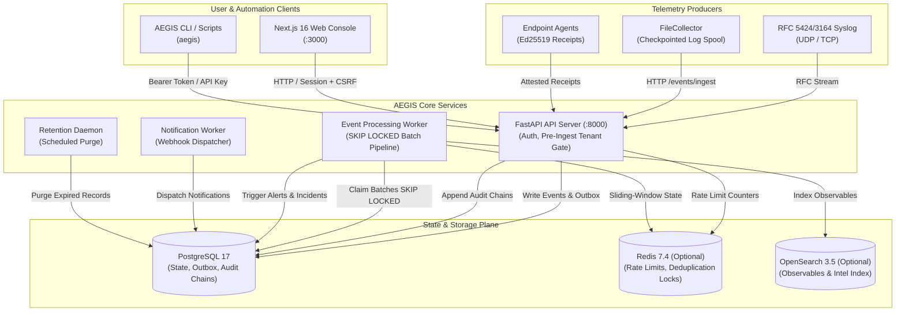
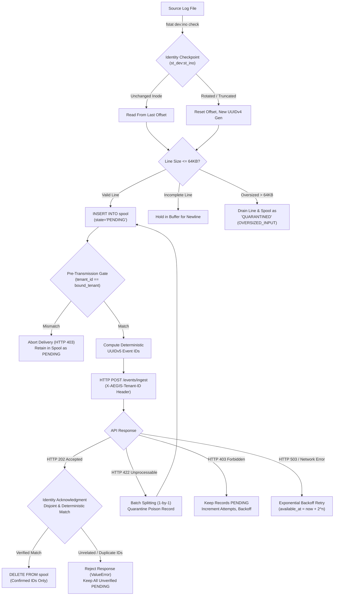
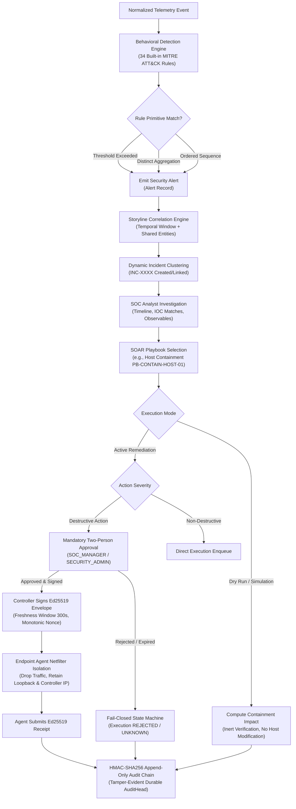

# AEGIS - Security Intelligence & Operations Platform

[](LICENSE)
[](pyproject.toml)
[](https://fastapi.tiangolo.com)
[](https://nextjs.org)
[](https://www.postgresql.org)
[](https://redis.io)
[](https://opensearch.org)
[](tests/)
[-brightgreen.svg)](scripts/integration_gate.py)
[](docs/validation/telemetry-recovery-qualification.md)
[](web/tests/)

> **AEGIS is an open-source, multi-tenant Security Information and Event Management (SIEM) and Security Orchestration, Automation, and Response (SOAR) platform engineered for enterprise security operations teams, security analysts, and incident responders.**

---

## Table of Contents

1. [Platform Overview & Intended Users](#platform-overview--intended-users)
2. [Current Capabilities & Maturity](#current-capabilities--maturity)
3. [Architecture Overview & Diagrams](#architecture-overview--diagrams)
   - [Runtime Services & Data Flow](#1-runtime-services--data-flow)
   - [Telemetry Spooling, Delivery & Acknowledgment](#2-telemetry-spooling-delivery--acknowledgment-lifecycle)
   - [Detection-to-Investigation-to-Response Workflow](#3-detection-to-investigation-to-approved-response-workflow)
4. [Prerequisites & System Requirements](#prerequisites--system-requirements)
5. [Quick Start & Running AEGIS](#quick-start--running-aegis)
   - [Staging Mode (Containerized Stack)](#1-staging-mode-containerized-stack)
   - [Local Development Mode](#2-local-development-mode)
6. [Safe Credential Setup & Retrieval](#safe-credential-setup--retrieval)
7. [Simulation, Demo & Acceptance Tooling](#simulation-demo--acceptance-tooling)
8. [Testing & Quality Assurance](#testing--quality-assurance)
9. [Troubleshooting Guide](#troubleshooting-guide)
10. [Known Operational Limitations](#known-operational-limitations)
11. [External Qualification Blockers](#external-qualification-blockers)
12. [Contributing & Security Reporting](#contributing--security-reporting)
13. [License](#license)

---

## Platform Overview & Intended Users

AEGIS provides a self-hosted, tenant-isolated operations control plane that unifies:
- High-throughput syslog and file telemetry ingestion with deterministic UUIDv5 event identities.
- Behavioral threat detection mapped to the MITRE ATT&CK enterprise matrix.
- Automated multi-alert storyline correlation and dynamic incident clustering.
- Asymmetric Ed25519 endpoint cryptographic attestation and host containment.
- Append-only HMAC-SHA256 audit log chains anchored to durable database heads.
- Authenticated `AGBK` v1 cold disaster recovery envelopes.

**Intended Users:**
- **Security Operations Center (SOC) Teams:** Triage alerts, track multi-stage attack storylines, and investigate related entities.
- **Incident Responders:** Execute human-in-the-loop active response containment playbooks with dual-authorization governance.
- **Security & Systems Engineers:** Deploy resilient file collectors and endpoint agents across Linux and Windows environments with verifiable at-least-once delivery.

---

## Current Capabilities & Maturity

| Capability | Implementation | Qualification Status |
| :--- | :--- | :---: |
| **Ingestion Pipeline** | Schema-validated HTTP and RFC 5424/3164 Syslog with tenant pre-ingest locking | **Verified** |
| **Telemetry Delivery** | Inode-checkpointed SQLite WAL spool, batch splitting, and UUIDv5 acknowledgments | **Verified (12/12 Scenarios)** |
| **Behavioral Detection** | 34 built-in threshold, sequence, and distinct aggregation MITRE ATT&CK rules | **Verified (34/34 Passed)** |
| **Storyline Correlation** | Temporal clustering across hosts, users, IPs, and observables | **Verified** |
| **SOAR Active Response** | Mandatory two-person authorization, dry-run simulation, Ed25519 envelopes | **Verified** |
| **Host Containment** | Netfilter isolation preserving loopback and controller IP communication | **Verified** |
| **Audit Integrity** | Append-only HMAC-SHA256 sequential entry chains with durable `AuditHead` | **Verified** |
| **Disaster Recovery** | Fernet AES-128 + PBKDF2 100k + SHA-256 authenticated `AGBK` v1 backup | **Verified** |
| **Containerized Integration**| PostgreSQL 17, Redis 7.4, and OpenSearch 3.5 distributed release gate | **Verified (62/62 Passed)** |

> [!NOTE]
> All software components and test gates have passed automated verification. Production readiness remains blocked pending four external enterprise infrastructure prerequisites documented in [Section 11](#external-qualification-blockers).

---

## Architecture Overview & Diagrams

### 1. Runtime Services & Data Flow



### 2. Telemetry Spooling, Delivery & Acknowledgment Lifecycle



### 3. Detection-to-Investigation-to-Approved-Response Workflow



---

## Prerequisites & System Requirements

- **Operating System:** Linux (Ubuntu 22.04+ / Debian 12+), macOS, or Windows 11 (with PowerShell 5.1+ or WSL2)
- **Python:** `3.12` or higher (tested on 3.12, 3.13, 3.14)
- **Node.js:** `24.0.0` or higher (with `npm`)
- **Docker & Docker Compose:** Docker Desktop 4.20+ or Docker Engine 24.0+ with Compose v2.20+

---

## Quick Start & Running AEGIS

### 1. Staging Mode (Containerized Stack)

To run the complete AEGIS container infrastructure (PostgreSQL 17, Redis 7.4, OpenSearch 3.5):

```bash
# Start background infrastructure
docker compose up -d postgres redis opensearch

# Verify container health
docker compose ps
```

Ensure all services report `(healthy)`:
- `aegis-postgres-1` on `127.0.0.1:5432`
- `aegis-redis-1` on `127.0.0.1:6379`
- `aegis-opensearch-1` on `127.0.0.1:9200`

### 2. Local Development Mode

```bash
# 1. Create and activate Python virtual environment
python -m venv .venv
# Windows PowerShell:
.venv\Scripts\activate
# Linux / macOS:
source .venv/bin/activate

# 2. Install locked dependencies
python -m pip install -c requirements.lock -e ".[dev]"
npm --prefix web ci

# 3. Generate cryptographic local configuration
python scripts/configure.py

# 4. Start all services concurrently
python scripts/dev.py dev
```

This concurrently launches:
- **FastAPI API Server:** [`http://127.0.0.1:8000`](http://127.0.0.1:8000) (OpenAPI Swagger Documentation: [`http://127.0.0.1:8000/docs`](http://127.0.0.1:8000/docs))
- **Background Event Worker:** Outbox processing and detection engine
- **Notification Delivery Worker:** Webhook and alert dispatcher
- **Next.js Web Console:** [`http://localhost:3000`](http://localhost:3000)

---

## Safe Credential Setup & Retrieval

AEGIS uses environment-driven configuration stored in local, ignored `.env` files. Secrets are generated cryptographically and never committed to version control.

1. **Initial Generation:**
   ```bash
   python scripts/configure.py
   ```
   This generates high-entropy 256-bit secrets for `AUDIT_SECRET`, database passwords, and the initial administrator account.

2. **Retrieving Operator Credentials:**
   Open your local `.env` file (never print it to logs):
   - **Username:** Value of `BOOTSTRAP_USERNAME` (default: `admin`)
   - **Password:** Value of `BOOTSTRAP_PASSWORD` in `.env`

3. **Logging In:**
   - Navigate to [`http://localhost:3000`](http://localhost:3000).
   - Sign in using `admin` and your password from `.env`.

---

## Simulation, Demo & Acceptance Tooling

AEGIS includes developer and qualification CLI commands:

```bash
# 1. Offline Detection Simulator (zero ingestion, no database writes)
aegis --format json rules simulate --dataset AUTH-001

# 2. Synthetic Multi-Tenant Workflow Demo
python scripts/dev.py demo

# 3. Live OpenSSH Container Telemetry Acceptance
# Spawns real OpenSSH 10.3p1 container, emits real syslogd telemetry, verifies rules & audit
python scripts/dev.py demo --live

# 4. Telemetry Failure Recovery & Isolation Acceptance (12 Scenarios)
# Exercises real network stop/restart, inode log rotation, batch splitting, and cross-tenant rejections
python scripts/dev.py recovery

# 5. Offline Rule Syntax and Logic Verification
aegis rules test --all
```

---

## Testing & Quality Assurance

AEGIS maintains a multi-tiered qualification suite. Exact counts from the latest qualification:

| Verification Gate | Command | Result | Evidence Document |
| :--- | :--- | :---: | :--- |
| **Python Non-Integration** | `pytest -m "not integration"` | **689 passed, 19 skipped, 11 deselected** | [`tests/`](tests/) |
| **PostgreSQL-Only Gate** | `python scripts/dev.py integration --postgres-only` | **58 passed, 0 skipped, 2 deselected** | [`build/integration-qualification.json`](file:///d:/Project/Aegis/build/integration-qualification.json) |
| **Distributed Full Gate** | `python scripts/dev.py integration` | **62 passed, 0 skipped, 0 deselected** | [`build/integration-qualification.json`](file:///d:/Project/Aegis/build/integration-qualification.json) |
| **Live OpenSSH Acceptance** | `python scripts/dev.py demo --live` | **70 events ingested, 3 rules triggered, audit valid** | [`docs/validation/real-telemetry-workflow-qualification.md`](docs/validation/real-telemetry-workflow-qualification.md) |
| **Telemetry Recovery Harness** | `python scripts/dev.py recovery` | **12/12 scenarios passed** | [`docs/validation/telemetry-recovery-qualification.md`](docs/validation/telemetry-recovery-qualification.md) |
| **Frontend Unit Tests** | `npm --prefix web test` | **35 passed across 8 test suites** | [`web/tests/`](web/tests/) |
| **Frontend Production Build** | `npm --prefix web run build` | **Compiled successfully (Turbopack)** | [`web/`](web/) |
| **Detection Rules** | `aegis rules test --all` | **34 passed, 0 failed** | [`rules/`](rules/) |
| **Dependency Audits** | `pip-audit` & `npm audit` | **0 known vulnerabilities** | [`requirements.lock`](requirements.lock) |

---

## Troubleshooting Guide

### 1. Docker Unavailable or Daemon Offline
- **Symptom:** `failed to connect to the docker API at npipe:////./pipe/dockerDesktopLinuxEngine` or `OperationalError: Connection refused` in worker.
- **Resolution:** Start Docker Desktop. Once running, execute `docker compose up -d postgres redis opensearch` and confirm ports `5432`, `6379`, `9200` are bound.

### 2. Database Selection & SQLite Lock Contention
- **Symptom:** Worker logs `worker_iteration_failed, error_type: OperationalError` during concurrent transactions.
- **Resolution:** SQLite does not support row-level locking (`SKIP LOCKED`). For concurrent development, ensure `DATABASE_URL` in `.env` points to PostgreSQL:
  ```env
  DATABASE_URL=postgresql+psycopg://aegis:<password>@127.0.0.1:5432/aegis
  ```

### 3. Login Rate Limiting & Account Lockouts
- **Symptom:** Web console displays `Rate limit exceeded; retry later` or `Invalid credentials or account temporarily locked`.
- **Resolution:** The authentication endpoint restricts login attempts to 10 per IP sliding window, and locks accounts after 5 failed attempts for 15 minutes. To reset immediately in local development:
  ```powershell
  .venv\Scripts\python -c "from aegis.config import get_settings; from aegis.db import database, User; from sqlalchemy import select; s=get_settings(); e,sess=database(s.database_url); [u.__setattr__('failed_logins', 0) or u.__setattr__('locked_until', 0) for db in [sess()] for u in [db.scalar(select(User).where(User.username=='admin'))] if u]; db.commit()"
  ```

### 4. Development Content Security Policy (Next.js Turbopack)
- **Symptom:** Browser console error `eval() is not supported in this environment... Turbopack`.
- **Resolution:** React development mode requires `eval()` to reconstruct sourcemap call stacks. In [`web/next.config.ts`](web/next.config.ts), `'unsafe-eval'` is scoped strictly to development (`process.env.NODE_ENV !== "production"`). Production builds enforce the strict policy without `unsafe-eval`.

---

## Known Operational Limitations

1. **Copy-Truncate Log Rotation Race Window:**
   In `copytruncate` log rotation, the operating system copies the file and truncates it in two non-atomic steps. Lines written between the copy and truncate operations are lost. Rename-and-reopen rotation (`kill -HUP` or `create` mode) is required for zero-loss delivery.
2. **Unflushed Operating System Page Buffers:**
   Log records written by producer processes that reside in OS page cache without `fsync` will be lost during unexpected hardware power loss.
3. **Spool Capacity Exhaustion:**
   When the SQLite spool reaches `capacity` (default: 100,000 records), source checkpoint advancement halts until connectivity to the API is restored.

---

## External Qualification Blockers

While all software components and CI steps pass automated testing, **Production Readiness remains BLOCKED** pending the execution of four external operational prerequisites:

1. **Enterprise PKI:** Provisioning real CA-signed certificates (`*.aegis.internal`) into live daemon mount points.
2. **Target Fleet Linux Containment Canary:** Validating netfilter containment against physical bare-metal enterprise Linux hosts.
3. **Physical Cloud Disaster Recovery Drill:** Executing an authenticated cold-restore drill against live AWS S3 Object Lock or GCP CMEK storage.
4. **24-Hour Continuous Multi-Worker Soak:** Executing an uninterrupted 24-hour multi-tenant concurrency soak test on persistent staging infrastructure.

---

## Contributing & Security Reporting

- **Contributing:** Review [CONTRIBUTING.md](CONTRIBUTING.md) for workflow guidelines and coding standards.
- **Security Vulnerabilities:** Do not report security vulnerabilities via public GitHub issues. Review [SECURITY.md](SECURITY.md) and submit confidential reports via [GitHub Private Vulnerability Reporting](https://github.com/aaryx/AEGIS/security/advisories/new) or email `aaryansingh24082005@gmail.com`.

---

## License

AEGIS is licensed under the **[MIT License](LICENSE)**.  
Copyright (c) 2026 Aaryan Singh. All rights reserved.
