# AEGIS Architecture & Component Boundaries

## 1. High-Level System Architecture

AEGIS is an enterprise Security Information and Event Management (SIEM) and Security Orchestration, Automation, and Response (SOAR) platform built around a single shared Python security core and unified FastAPI engine.

```mermaid
graph TD
    subgraph Ingestion Layer
        Syslog[Syslog Ingestion RFC 5424/3164 UDP/TCP/TLS] --> IngestPipeline[aegis/pipeline.py ingest]
        REST[REST API Ingestion /api/v1/events/ingest] --> IngestPipeline
        Collector[File/Journald Collector aegis/collector.py] --> IngestPipeline
    end

    subgraph Core Processing & Outbox
        IngestPipeline --> EventMeta[(PostgreSQL / SQLite events_metadata)]
        IngestPipeline --> SearchOutbox[(PostgreSQL search_jobs)]
        IngestPipeline --> AuditTrail[(Immutable Audit Log HMAC-SHA256)]
    end

    subgraph Worker Pool
        Worker[Detection Workers aegis/worker.py] -->|Row Lease SKIP LOCKED| EventMeta
        Worker --> Rules[MITRE ATT&CK Rules aegis/rules.py]
        Worker --> DetState[WindowState Sliding Windows]
        Worker --> Alerts[(alerts & incidents)]
        Worker --> SearchProjection[OpenSearch Outbox Projection]
    end

    subgraph SOAR & Endpoint Execution
        SOAR[SOAR Engine aegis/response.py] --> TwoPerson[Two-Person Approval State Machine]
        TwoPerson --> EndpointAgent[AEGIS Endpoint Daemon aegis/agent.py]
        EndpointAgent --> NetContainment[Host Firewall Isolation netsh/iptables]
        EndpointAgent --> ProcTerm[Process Termination]
        EndpointAgent --> Receipt[Cryptographic Execution Receipt]
    end

    subgraph Maintenance & Lifecycle
        Retention[Retention Worker aegis/retention.py] --> LegalHoldCheck{Legal Hold & Case Custody?}
        LegalHoldCheck -->|Protected| Preserve[Preserve Evidence]
        LegalHoldCheck -->|Expired| BoundedPrune[Bounded Batch Deletion & OpenSearch ISM]
    end

    subgraph Operator Consoles
        Console[Next.js 16 SOC Console web/] --> API[FastAPI Core aegis/api.py]
        CLI[Typer CLI aegis/cli.py] --> API
        API --> CoreDomain[Unified Domain Services]
    end
```

---

## 2. Component Boundaries & Responsibilities

### 2.1 Unified Security Core
- **Path**: `aegis/`
- **Guarantees**: Neither the Next.js console nor the CLI implements separate detection, normalization, RBAC, or response logic. All clients consume the same authoritative API endpoints and domain services.
- **Deterministic Detections**: Deterministic rule matching (`aegis/detection.py`) is the authoritative detection layer. AI assistance (`aegis/ai.py`) is strictly advisory, evidence-grounded, schema-constrained, and cannot authorize or execute containment playbooks.

### 2.2 Concurrency & Work Claiming Model
- **Batch Ingestion**: Event ingestion verifies tenant existence without locking the `Organization` row. Ingestion transactions are short and bounded by `settings.max_batch_events` (default 500) and `settings.max_event_bytes` (default 64KB).
- **Worker Claiming**: Detection workers query pending events using row-level `SELECT ... FOR UPDATE SKIP LOCKED` ordered by availability and timestamp. Multiple workers can claim and process independent event batches concurrently for the same organization without tenant-wide serialization.
- **Outbox Search Projection**: Event indexing into OpenSearch runs via an idempotent outbox pattern (`SearchJob`). Temporary search outages never block primary detection commits or alert generation.

### 2.3 Data Lifecycle & Maintenance Subsystem
- **Path**: `aegis/retention.py`
- **Privilege Separation**: Ordinary runtime credentials (`aegis_runtime`) have `DELETE` permissions revoked on `events_metadata` and `audit_logs`. The dedicated maintenance daemon (`aegis-retention`) operates under a narrowly scoped maintenance identity (`aegis_maintenance`).
- **Legal Hold**: Records referenced in open cases (`CaseEvidence`) or active alerts (`AlertEvent`) are excluded from deletion regardless of age.
- **Audit Tamper-Resistance**: `audit_logs` cannot be updated or deleted even by the maintenance identity.

### 2.4 Cryptographic SOAR Execution & Agent Boundary
- **Path**: `aegis/agent.py`, `aegis/response.py`
- **Two-Person Approval**: Actions in `HIGH_IMPACT` (`isolate_host`, `unisolate_host`, `terminate_process`, `disable_account`) require approval from an independent authenticated principal with `playbooks.approve`. Self-approval is strictly prevented.
- **Freshness & Expiration**: Approvals expire after `response_approval_seconds` (default 1 hour). Parameter alteration invalidates approval.
- **Receipt Verification**: Endpoint agents submit canonical HMAC-SHA256 execution receipts that must match the expected payload digest before status transitions to `VERIFIED`.
