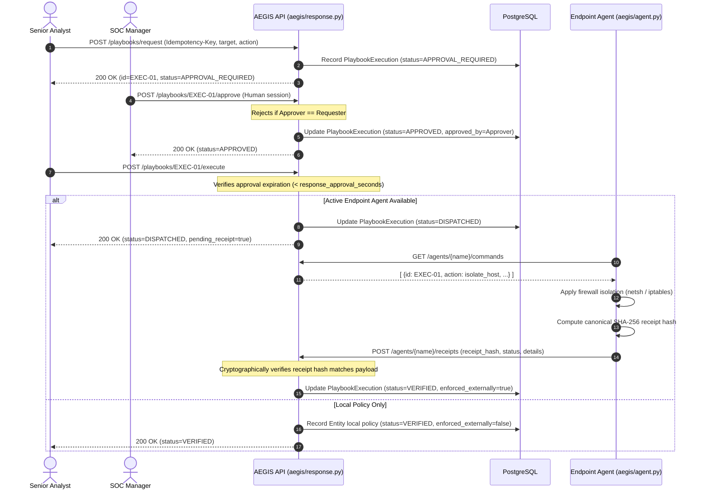

# AEGIS Incident Response & SOAR Playbook Runbook

## 1. Incident Lifecycle & Progression

Incident stages follow strict NIST SP 800-61 / SANS lifecycle stages. Progression must advance linearly:

`OPEN → TRIAGED → INVESTIGATING → CONTAINMENT → ERADICATION → RECOVERY → RESOLVED → CLOSED`

- Advancing backwards or skipping stages is rejected with `409 Conflict`.
- Transitioning to `RESOLVED` or `CLOSED` requires mandatory resolution notes.
- Optimistic concurrency control is enforced via `revision` counter; stale writes fail with `409 Conflict`.
- Assignees must belong to the authenticated organization.

---

## 2. Two-Person Controlled SOAR Playbook Execution

High-impact actions (`isolate_host`, `unisolate_host`, `terminate_process`, `disable_account`, `block_ioc`) cannot be executed by an individual analyst alone.



---

## 3. Host Isolation Emergency Rollback

If a machine is accidentally isolated or network containment needs to be lifted:

1. Request an un-isolation playbook:
   ```bash
   curl -X POST "http://localhost:8000/api/v1/playbooks/request" \
     -H "Authorization: Bearer <SENIOR_ANALYST_TOKEN>" \
     -H "Idempotency-Key: emergency-uniso-$(date +%s)" \
     -H "Content-Type: application/json" \
     -d '{"action": "unisolate_host", "target": "<ENTITY_ID_OR_HOSTNAME>"}'
   ```
2. Independent SOC Manager approves:
   ```bash
   curl -X POST "http://localhost:8000/api/v1/playbooks/<EXECUTION_ID>/approve" \
     -H "Authorization: Bearer <SOC_MANAGER_TOKEN>"
   ```
3. Dispatch execution:
   ```bash
   curl -X POST "http://localhost:8000/api/v1/playbooks/<EXECUTION_ID>/execute" \
     -H "Authorization: Bearer <SENIOR_ANALYST_TOKEN>"
   ```
4. On the endpoint, the agent automatically polls the command and deletes firewall rules (`netsh advfirewall firewall delete rule` on Windows, or `iptables -F` on Linux).
