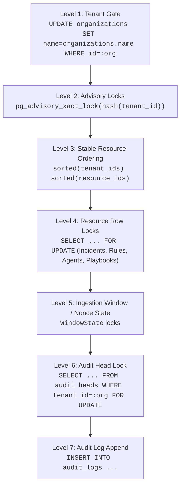

# AEGIS TITAN Phase 5 — Concurrency, Lock Hierarchy & Failure Matrix

**Date**: 2026-10-20
**Scope**: PostgreSQL Lock Ordering, Concurrency Races & Failure Resilience
**Document Ref**: `docs/validation/project-titan-phase5/CONCURRENCY_AND_FAILURE_MATRIX.md`

---

## 1. Global Lock Hierarchy

To guarantee deadlock-free execution across all concurrent API requests, background workers, SOAR playbooks, and database maintenance jobs, AEGIS enforces a strict 7-level global lock hierarchy. Every operation acquiring database locks MUST acquire them in strictly non-decreasing level order.

### Hierarchy Level Specifications

| Level | Lock Name / Mechanism | Scope | Purpose | Acquisition Rule |
|---|---|---|---|---|
| **Level 1** | **Tenant Gate** (`soar.lock_tenant`) | Single Organization | Coarse-grained exclusive serialization for all tenant-scoped mutations. | Must be acquired before any resource query or row lock. Issues `UPDATE organizations SET name=organizations.name WHERE id=:org`. Suppresses ORM autoflush. |
| **Level 2** | **PostgreSQL Advisory Lock** (`pg_advisory_xact_lock`) | Single Tenant Workflow | Dedicated lock space for high-volume background tasks (e.g. storyline correlation). | Only acquired after the tenant gate. Automatically released at transaction commit/rollback. |
| **Level 3** | **Stable Resource Ordering** (`sorted()`) | Multi-Resource Batches | Eliminates AB-BA deadlock cycles when an operation involves multiple organizations or entities. | Multi-tenant batches (retention, notifications) sort tenant IDs ascending. Storyline correlation sorts incident IDs ascending before acquiring row locks. |
| **Level 4** | **Resource Row Locks** (`SELECT ... FOR UPDATE`) | Specific Entities | Fine-grained row locking on `Incident`, `Alert`, `Case`, `Rule`, `Agent`, `PlaybookExecution`, `Delivery`. | Always acquired under Level 1/2. Re-verifies state eligibility after waiting for lock acquisition. |
| **Level 5** | **Window & Nonce State** | Ingestion & Agents | Prevents replay attacks and sliding-window counter races. | Acquired after resource locks and before audit generation. |
| **Level 6** | **Audit Head Lock** | Single Tenant Audit Head | Serializes HMAC-SHA256 hash chaining and sequence number incrementing. | Acquired inside `security.audit` via `SELECT ... FROM audit_heads WHERE tenant_id=:org FOR UPDATE`. |
| **Level 7** | **Audit Log Append** | Tenant Audit Record | Appends immutable audit record linking to the updated `AuditHead`. | Inserts row into `audit_logs` referencing previous hash. Committed atomically with the business mutation. |

---

## 2. Concurrency Scenarios & Adversarial Test Evidence

The following scenarios were verified in Phase 5 under multi-threaded and asynchronous adversarial conditions:

| Concurrency Scenario | Contention Mechanism | Expected Behavior | Observed Result | Test Reference |
|---|---|---|---|---|
| **Concurrent Incident Status Updates** | Two threads simultaneously submit `PUT /incidents/{id}/status` with conflicting statuses | Optimistic/pessimistic revision check: first update commits and increments revision; second update detects revision mismatch and returns HTTP 409 Conflict. No lost updates. | **Passed**. Thread 1 succeeded (revision 1 -> 2); Thread 2 received HTTP 409 Conflict; DB status matches Thread 1; AuditHead revision 2. | `test_concurrent_incident_status_updates_lost_update_prevention` |
| **Concurrent SOAR Approvals** | Two SOC managers simultaneously approve the same pending playbook execution | First approval acquires execution row lock, sets status `APPROVED`, and increments revision; second approval detects already approved state and returns HTTP 409 Conflict. | **Passed**. Exactly 1 approval accepted (HTTP 200); second rejected (HTTP 409); revision incremented exactly once. | `test_concurrent_soar_approval_race` |
| **Agent Revocation vs Receipt Submission** | Agent revocation and receipt submission occur simultaneously | Both acquire `soar.lock_tenant`. If revocation acquires first, agent row is marked `REVOKED`; receipt waiting on lock sees `REVOKED` state and fails closed with HTTP 403. | **Passed**. Revocation succeeds (HTTP 200); subsequent receipt rejected (HTTP 403); historical receipts preserved intact. | `test_concurrent_revocation_vs_receipt_submission` |
| **Simultaneous Duplicate Event Ingestion** | 4 threads simultaneously submit identical event payload | Pipeline acquires tenant gate; first thread inserts event; remaining 3 threads detect existing event ID or deduplication key and return duplicate status without inserting extra rows. | **Passed**. 4 simultaneous submissions: exactly 1 accepted, 3 returned as duplicates; exactly 1 event row created in database. | `test_simultaneous_duplicate_event_ingestion_race` |
| **Multi-Tenant Worker Queue Processing** | Concurrent worker processes dequeue events for Tenant A and Tenant B simultaneously | Tenant gates serialize within Tenant A and within Tenant B independently; zero cross-tenant lock contention or deadlocks. | **Passed**. Worker 1 and Worker 2 processed Org A and Org B in parallel without blocking each other or corrupting state. | `test_background_worker_multi_tenant_queue_processing` |
| **Concurrent Audit Writes (Single Tenant)** | Multiple threads append audit records for the same organization | Tenant gate serializes audit head updates; monotonic sequence numbers (`1, 2, ..., N`) and continuous HMAC-SHA256 chain maintained. | **Passed**. 8 concurrent writes produced sequence 1-8 without gaps; `verify_audit` returned clean verification. | `test_concurrent_audit_writes_same_tenant_serialized` |
| **Concurrent Audit Writes (Multi-Tenant)** | Multiple threads append audit records for distinct organizations | Independent tenant gates and disjoint `AuditHead` rows execute concurrently without serialization bottlenecks. | **Passed**. Tenants A, B, and C updated concurrently; all individual audit chains verified. | `test_concurrent_audit_writes_different_tenants_parallel` |

---

## 3. Database Engine Timeouts & Failure Recovery

To prevent hung transactions, thread starvation, and connection pool exhaustion, AEGIS configures bounded execution timeouts at the PostgreSQL driver and database engine levels:

| Parameter | Configured Value | Enforcement Location | Purpose |
|---|:---:|---|---|
| **Connection Timeout** | `5 seconds` | `create_engine(..., connect_args={"connect_timeout": 5})` | Fails fast if PostgreSQL server or network is unresponsive. |
| **Lock Timeout** | `5 seconds` | `SET lock_timeout = '5000ms'` | Prevents indefinite waiting on locked rows; raises `QueryCanceledError` / `DBAPIError` if lock cannot be acquired within 5s. |
| **Statement Timeout** | `30 seconds` | `SET statement_timeout = '30000ms'` | Aborts runaway queries or unindexed scans before exhausting server CPU/memory. |
| **SQL Parameter Redaction** | `hide_parameters=True` | SQLAlchemy Engine Configuration | Prevents sensitive parameters (passwords, tokens, API keys) from leaking into application exception logs. |

### Failure Recovery Behavior
1. **Deadlock / Lock Timeout Recovery**:
   - When a transaction encounters a `DeadlockDetected` or `LockNotAvailable` exception from PostgreSQL, the active session is immediately rolled back (`session.rollback()`).
   - The worker catches the failure, increments the retry backoff counter, and releases all locks.
   - Mutating API endpoints return HTTP 409 Conflict or HTTP 503 Service Unavailable with appropriate retry headers.
2. **Database Disconnection Recovery**:
   - Connection drops during transactions trigger immediate fail-closed rollback.
   - The SQLAlchemy connection pool discards invalidated connections and re-establishes TCP connections using SCRAM authentication and TLS encryption on subsequent requests.
   - Background workers sleep for 5 seconds upon connection failure before initiating reconnection attempts.

---

## 4. Trade-Offs, Throughput Implications & Scalability

### Tenant Gate Serialization Trade-Off
- **Advantage**: Coarse-grained tenant serialization via `soar.lock_tenant` provides mathematically verifiable deadlock prevention and eliminates complex multi-row race conditions across interrelated tables (Incidents, Alerts, Nonces, AuditHeads).
- **Throughput Limit (Single Tenant)**: A single tenant's mutating operations are bounded by the database transaction commit rate (typically ~500–1,500 mutations/sec on high-performance PostgreSQL NVMe storage).
- **Scalability (Multi-Tenant)**: The system scales horizontally across tenants. Ten distinct tenants can execute mutating operations simultaneously with zero database lock contention between them.
- **Operational Recommendation**: Long-running read queries (investigations, analytics, dashboards) must NEVER acquire tenant gates or row locks; they execute in read-committed isolation mode to avoid blocking ingestion or SOAR operations.
