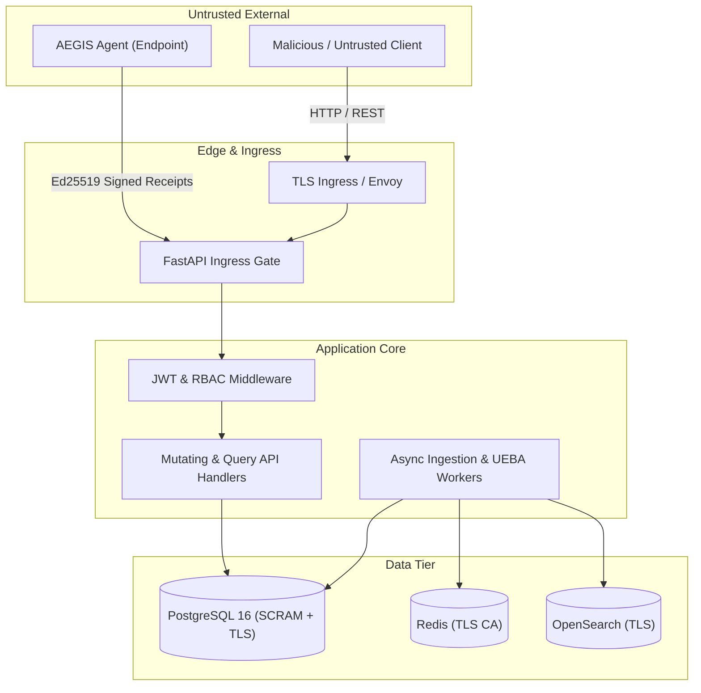

# AEGIS TITAN Phase 5 — Threat Model & Adversarial Analysis

**Date**: 2026-10-20
**Scope**: AEGIS SIEM & SOAR Multi-Tenant Production Architecture
**Document Ref**: `docs/validation/project-titan-phase5/THREAT_MODEL.md`

---

## 1. System Overview & Trust Boundaries

AEGIS is a high-assurance multi-tenant Security Information and Event Management (SIEM) and Security Orchestration, Automation, and Response (SOAR) platform. The system operates across four primary security boundaries:

### Trust Boundary Definitions
1. **Multi-Tenant Boundary (Horizontal)**: Strict logical separation between distinct tenant organizations. No tenant may observe, query, mutate, lock, or exhaust resources belonging to another tenant.
2. **Role-Based Privilege Boundary (Vertical)**: Access control based on user roles (`VIEWER` < `ANALYST` < `SOC_MANAGER` < `SECURITY_ADMIN` < `SUPER_ADMIN`). Low-privilege users must not perform unauthorized mutations.
3. **Agent & Host Boundary (Edge)**: Enrolled agents operate on untrusted remote hosts. All containment receipts and status updates must be cryptographically signed via Ed25519 and verified against the registered public key for an active, unrevoked agent.
4. **Data Tier & Transport Boundary (Internal)**: Communication between application workers and storage engines (PostgreSQL, Redis, OpenSearch) must enforce authentication, TLS encryption, and fail-closed network policies.

---

## 2. Threat Actors & Capabilities

| Threat Actor | Access Level | Objectives | Assumed Capabilities |
|---|---|---|---|
| **External Attacker** | Unauthenticated Network | Denial of service, remote code execution, authentication bypass | TCP traffic injection, malformed JSON payloads, replay attacks, resource exhaustion floods. |
| **Malicious Tenant Insider** | Authenticated as Tenant A | Horizontal privilege escalation, cross-tenant data exfiltration, cross-tenant mutation | Valid JWT for Tenant A, knowledge of public API endpoints, ability to forge request payloads and manipulate IDs. |
| **Low-Privilege Insider** | Authenticated as `VIEWER`/`ANALYST` | Vertical privilege escalation, unauthorized rule modification, playbook execution | Valid session token, ability to invoke mutating endpoints directly via HTTP clients. |
| **Compromised Endpoint Agent** | Possesses revoked or forged Agent Key | Report false containment enforcement, evade quarantine, replay stale receipts | Full control over endpoint host, memory extraction of local private keys, clock manipulation. |
| **Malicious Database Operator** | Direct SQL Read/Write | Cover tracks, alter historical alerts, modify audit records | Direct access to PostgreSQL tables, ability to update or delete rows directly via SQL. |

---

## 3. Attack Surfaces Analyzed & Adversarial Findings

### 3.1 Horizontal Tenant Isolation

| Attack Vector | Tested Technique | Observed System Response | Security Mechanism | Test Reference |
|---|---|---|---|---|
| **Incident Cross-Read** | Tenant A attempts `GET /api/v1/incidents/{tenant_b_id}` | HTTP 404 (`HTTP_404: Resource does not exist`) | Server-side tenant filtering: query explicitly binds `organization_id == current_user.org_id`. | `test_cross_tenant_incident_access_blocked` |
| **Incident Cross-Update** | Tenant A attempts `PUT /api/v1/incidents/{tenant_b_id}/status` | HTTP 404; Target DB row unchanged; AuditHead unchanged | Status handler locks caller tenant first; query on incident returns None; raises 404 before mutation. | `test_cross_tenant_incident_status_update_blocked` |
| **Alert Cross-Link** | Tenant A attempts to link Tenant B's alert to Tenant A's incident | HTTP 404; Zero alert link rows created | Alert lookup filters by caller `organization_id`; raises 404. | `test_cross_tenant_alert_linking_blocked` |
| **Case Evidence Injection** | Tenant A attempts `POST /api/v1/cases/{tenant_b_id}/evidence` | HTTP 404; Target case has zero foreign evidence rows | Case lookup filters by caller tenant; non-matching ID fails closed. | `test_cross_tenant_case_access_and_evidence_attachment_blocked` |
| **Detection Rule Overwrite** | Tenant A attempts to overwrite Tenant B's detection rule | HTTP 409 Conflict / HTTP 404; Rule content unmodified | Rule lookup filters by caller tenant; global name collision rejects write. | `test_cross_tenant_rule_manipulation_blocked` |
| **SOAR Cross-Execution** | Tenant A attempts to approve Tenant B's playbook execution | HTTP 404; Execution state remains unchanged | Playbook execution lookup filters by caller tenant. | `test_cross_tenant_playbook_execution_and_approval_blocked` |
| **Agent Cross-Revocation** | Tenant A attempts `POST /api/v1/agents/{tenant_b_agent}/revoke` | HTTP 404; Agent status remains `ENROLLED` | Agent lookup scoped to caller tenant under `soar.lock_tenant`. | `test_cross_tenant_agent_revocation_blocked` |
| **Integration Webhook Retry** | Tenant A attempts `POST /api/v1/integrations/deliveries/{b_id}/retry` | HTTP 404; Delivery status unchanged | Delivery lookup scoped to caller organization ID. | `test_cross_tenant_webhook_and_integration_delivery_blocked` |
| **Payload ID Spoofing** | Tenant A sends `{"organization_id": "tenant-b", ...}` in request body | HTTP 422 Unprocessable Entity or strict tenant override | Pydantic `StrictModel(extra="forbid")` rejects unexpected fields; server extracts tenant strictly from verified JWT. | `test_manipulated_organization_id_in_payload_rejected` |
| **Tenant Enumeration / Timing** | Tenant A probes nonexistent ID vs Tenant B valid ID | Identical HTTP 404 status, identical error code, identical message | Uniform error contract: both paths execute identical DB queries and return identical body structure. | `test_uniform_404_error_contract_prevents_tenant_enumeration` |

### 3.2 Vertical Privilege Escalation & Role Enforcement

| Role | Tested Operation | Expected Outcome | Verified Result |
|---|---|---|---|
| `VIEWER` | Update incident status (`PUT /api/v1/incidents/{id}/status`) | HTTP 403 Forbidden | Blocked by `require_role(Role.ANALYST)` |
| `VIEWER` | Ingest events (`POST /api/v1/events/ingest`) | HTTP 403 Forbidden | Blocked by `require_role(Role.ADMIN)` |
| `ANALYST` | Ingest events (`POST /api/v1/events/ingest`) | HTTP 403 Forbidden | Blocked by `require_role(Role.ADMIN)` |
| `ANALYST` | Approve SOAR execution (`POST .../approve`) | HTTP 403 Forbidden | Blocked by `require_role(Role.SOC_MANAGER)` |
| `SOC_MANAGER` | Approve own SOAR execution (Creator == Approver) | HTTP 403 Forbidden | Blocked by Two-Person rule enforcement |
| Any | Missing, malformed, or expired Bearer token | HTTP 401 Unauthorized | Blocked by `get_current_user` JWT validation |

### 3.3 Endpoint Agent Security & Cryptographic Receipts

1. **Receipt Signature Verification**:
   - Every containment receipt submitted via `POST /api/v1/agents/{id}/receipt` requires an Ed25519 digital signature over the canonical message `f"{execution_id}:{action}:{target}:{enforced}:{timestamp}"`.
   - Modifying a single character of the action or target payload causes signature verification to fail immediately (HTTP 400 Bad Request).
   - Test verified: `test_agent_receipt_signature_verification_and_tampering` in `tests/test_phase5_soar_containment.py`.
2. **Revocation Race Resilience**:
   - When an agent is revoked via `POST /api/v1/agents/{id}/revoke`, the operation acquires `soar.lock_tenant` and updates agent status to `REVOKED`.
   - If an agent attempts to submit a receipt concurrently, the receipt handler waits for the tenant lock, refreshes the agent row from the database, observes the `REVOKED` state, and rejects the submission with HTTP 403 Forbidden.
   - Historical receipts accepted prior to revocation remain immutable and valid.
   - Test verified: `test_agent_revocation_race_fails_closed` and `test_concurrent_revocation_vs_receipt_submission`.
3. **Fail-Closed Containment Status Machine**:
   - Containment status cannot be reported as `ENFORCED` unless verified evidence containing an active `nftables-v1` policy SHA-256 hash match is persisted.
   - Absence of verification evidence or receipt mismatch forces the containment state to `UNKNOWN`.
   - Test verified: `test_containment_status_fail_closed_unknown_state`.

### 3.4 Ingestion Denial of Service & Resource Exhaustion

1. **Payload Size Bounds**:
   - Ingestion payloads exceeding 256KB are rejected at the HTTP router before parsing (HTTP 422).
   - Tested: `test_oversized_payload_rejected_at_admission`.
2. **String & Field Length Limits**:
   - Individual string values exceeding 64KB (e.g. giant usernames or command lines) are rejected by Pydantic field validators (HTTP 422).
   - Tested: `test_excessive_string_length_rejected`.
3. **JSON Depth Protection**:
   - Deeply nested recursive JSON objects (>20 levels) designed to exhaust parser call stacks are detected and rejected (HTTP 422).
   - Tested: `test_deeply_nested_json_rejected`.
4. **Clock Skew Constraints**:
   - Event timestamps must be timezone-aware (rejects naive timestamps with HTTP 422).
   - Event timestamps more than 5 minutes in the future are rejected with HTTP 422 (`"Event timestamp exceeds allowed future clock skew"`).
   - Valid past timestamps (historical logs) are accepted up to retention limits.
   - Tested: `test_invalid_and_skewed_timestamps_rejected`.
5. **Batch Size Envelopes**:
   - Event batches exceeding 2000 events are rejected in toto with HTTP 422.
   - Tested: `test_batch_size_limit_enforced`.
6. **Queue Backpressure & Saturation**:
   - Admission queue checks tenant backlog (`PENDING` + `RETRY` events) under the tenant gate.
   - When queue depth reaches configured capacity, admission returns HTTP 503 Service Unavailable with a `Retry-After: 10` header.
   - Tested: `test_admission_control_queue_saturation_backpressure`.

### 3.5 Audit Trail Integrity & Tamper Evident Verification

1. **HMAC-SHA256 Hash Chaining**:
   - Every audit record computes `current_hash = HMAC_SHA256(key, f"{tenant_id}:{sequence_num}:{event_type}:{payload_json}:{prev_hash}")`.
   - Each tenant maintains an independent, strictly monotonic sequence number and `prev_hash` chain stored in `AuditHead`.
2. **Atomic Transactional Coupling**:
   - Business mutations (e.g. incident status update) and their corresponding audit record insert commit inside the exact same database transaction.
   - If an unhandled exception or database error occurs, both the mutation and the audit record roll back together. The `AuditHead` sequence number does not advance.
   - Tested: `test_atomic_mutation_audit_coupling` and `test_audit_transaction_rollback_head_consistency`.
3. **Cryptographic Tamper Detection**:
   - Direct database modification of any audited field (payload alteration, sequence renumbering, row deletion, record reordering, or head desync) is detected by `verify_audit()`.
   - Tested: `test_audit_chain_tamper_detection_mechanisms`.

---

## 4. Residual Threats & Defense-in-Depth Measures

| Residual Threat | Current Risk Level | Architectural Defense | Operational Mitigation Required |
|---|:---:|---|---|
| **Direct Database Compromise (DBA Superuser)** | Low / Medium | Audit records are hash-chained. Tampering breaks the HMAC chain. | Ship audit logs to an external write-once-read-many (WORM) storage target (e.g., AWS S3 Object Lock) in production. |
| **Worker Host Compromise** | Low | Application workers run unprivileged; no shell execution enabled; memory encryption supported. | Enforce container read-only root filesystems and minimal runtime images (Distroless). |
| **Distributed Denial of Service (DDoS)** | Low | Redis sliding-window rate limiting; database admission backpressure; payload size limits. | Deploy an external WAF / DDoS mitigation layer (e.g., Cloudflare / AWS Shield) in front of the public ingress. |
| **Physical Host Network Partition** | Low | Ingestion queues buffer in Redis/PostgreSQL; workers retry with exponential backoff. | Multi-AZ PostgreSQL high availability with automated streaming replication failover. |
