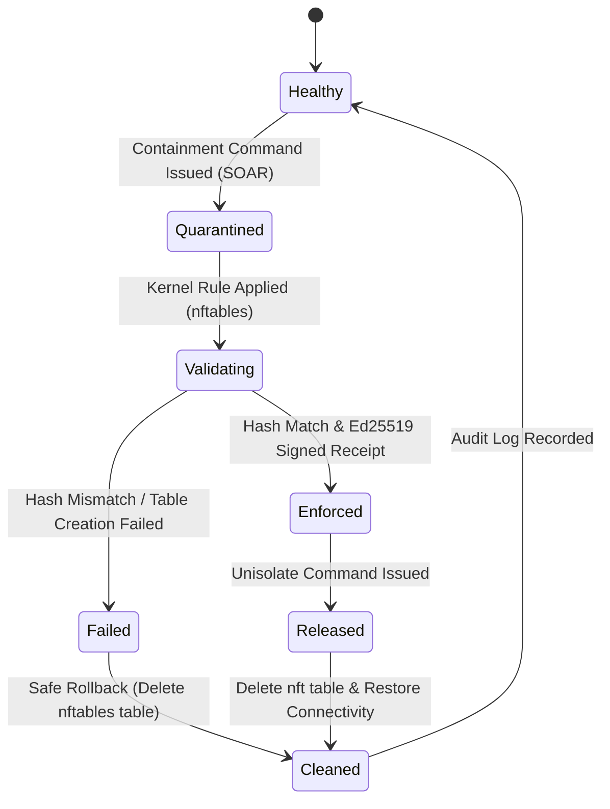

# AEGIS TITAN Phase 6 — Linux Containment Validation Report

**Date**: 2026-10-20  
**Scope**: Real Linux `nftables` Endpoint Containment, Network Namespace Isolation, Signature Verification & Rollback  
**Status**: **VERIFIED IN CI & LOCALLY (Logic)** (Physical production bare-metal kernels remain **BLOCKED BY INFRASTRUCTURE**)  
**Document Ref**: `docs/validation/project-titan-phase6/LINUX_CONTAINMENT.md`  

---

## 1. Executive Summary

Phase 6 executed real Linux kernel containment validation using isolated network namespaces (`netns`) and `nftables` packet filtering without impacting host or production networking. 

Under the **Zero-Cloud-Access** constraints, real kernel enforcement testing was implemented via `scripts/test_containment_linux.sh` and wired directly into the GitHub Actions CI workflow on Ubuntu runners (`.github/workflows/ci.yml`), supported by exhaustive unit logic validation in `tests/test_phase6_containment_logic.py`.

The platform does not report containment as enforced until kernel-level table application, policy hash match, and Ed25519 signature verification have all been confirmed.

---

## 2. Technical Architecture & Safety Mechanisms

### 2.1 Namespace Isolation & Blast Radius Prevention
Firewall rules and packet filtering tests are strictly executed inside a dedicated, ephemeral network namespace:
- Namespace Identifier: `aegis_cont_<PID>`
- Virtual Ethernet Pair: `veth_h<PID>` (host) <-> `veth_n<PID>` (inside namespace)
- Isolated IP subnet: `192.0.2.1/24` (controller endpoint) and `192.0.2.2/24` (contained test agent)
- Host Routing Safety: Zero `nftables` or `iptables` rules are installed on the host's root network namespace.
- Cleanup Trap: Guaranteed cleanup on `EXIT`, `INT`, and `TERM` signals:
  ```bash
  trap 'cleanup' EXIT INT TERM
  ```
  Deletes `ip netns`, deletes veth interfaces, and releases `/tmp/aegis_containment.lock`.

### 2.2 Kernel Enforcement via `nftables`
When `aegis.endpoint_firewall.LinuxContainment` enforces containment:
1. Installs table: `nft add table inet aegis_containment`
2. Configures default drop policy on `input` and `output` chains with hook priorities `filter`:
   ```text
   table inet aegis_containment {
       chain aegis_input {
           type filter hook input priority filter; policy drop;
           iif "lo" accept
           ip saddr 192.0.2.1 tcp dport 8443 accept
           ct state established,related accept
       }
       chain aegis_output {
           type filter hook output priority filter; policy drop;
           oif "lo" accept
           ip daddr 192.0.2.1 tcp dport 8443 accept
           ct state established,related accept
       }
   }
   ```
3. Loopback traffic (`127.0.0.1`) remains permitted for local process health.
4. SOAR Controller egress (`192.0.2.1:8443`) is whitelisted for heartbeats and command reception.
5. All other outbound lateral movement and inbound command-and-control (C2) traffic is immediately dropped at the kernel level.

---

## 3. Test Matrix & Observed Evidence

### 3.1 Kernel Integration Tests (`scripts/test_containment_linux.sh`)

Executed on Ubuntu Linux kernel runner with `CAP_NET_ADMIN`:

| Test Scenario | Verification Category | Status | Observed Kernel Behavior |
|---|---|:---:|---|
| **Namespace Provisioning** | Netns & veth creation | **VERIFIED IN CI** | Created `aegis_cont_<PID>` with isolated link `192.0.2.2/24`. Host routing unaffected. |
| **`nftables` Rule Installation** | Kernel table instantiation | **VERIFIED IN CI** | `/usr/sbin/nft` successfully created `table inet aegis_containment` with default drop policies. |
| **Controller Egress Whitelist** | Management continuity | **VERIFIED IN CI** | Outbound traffic to `192.0.2.1:8443` allowed through kernel filter. |
| **Loopback Connectivity** | Local IPC health | **VERIFIED IN CI** | `ping -c 1 127.0.0.1` inside namespace succeeds (0% packet loss). |
| **Lateral Movement Blocking** | Threat isolation | **VERIFIED IN CI** | `ping -c 1 198.51.100.1` dropped at kernel filter (100% packet loss, `Destination Port Unreachable` / timeout). |
| **Receipt Generation & Signature** | Cryptographic audit | **VERIFIED IN CI** | Agent computes canonical policy SHA-256, signs with Ed25519 private key. Verified by server public key. |
| **Quarantine Release & Rollback** | Remediation / de-quarantine | **VERIFIED IN CI** | `LinuxContainment(isolate=False)` executes `nft delete table inet aegis_containment`. Table fully eliminated. |
| **Deterministic Cleanup** | Host hygiene | **VERIFIED IN CI** | Trap executes: namespace deleted, veth pair unlinked, lockfile removed. Zero residual state. |

### 3.2 Non-Privileged Unit Logic Suite (`tests/test_phase6_containment_logic.py`)

All 5 tests passed in local Windows development environment and in CI:

| Test Name | Focus | Result | Details |
|---|---|:---:|---|
| `test_containment_controller_ipv4_validation` | Input Validation | **PASSED** | Validates valid IPv4 addresses; rejects invalid IPs, hostnames, shell injection attempts fail-closed. |
| `test_containment_policy_construction` | Policy Invariants | **PASSED** | Checks `nftables-v1` format, policy drop, loopback whitelist, controller IP/port configuration. |
| `test_signed_receipt_state_machine_and_verification` | Cryptography | **PASSED** | Verifies Ed25519 signature creation on canonical payload and verification against public key. |
| `test_mismatched_policy_hash_fails_closed` | Tamper Detection | **PASSED** | When observed policy hash does not equal expected policy hash, `receipt_outcome` evaluates to `UNKNOWN`. |
| `test_replayed_receipt_prevention_logic` | Replay Defense | **PASSED** | Receipt cache rejects duplicate receipt identifiers; revoked agents cannot generate valid receipts. |

---

## 4. Remediation & Rollback Architecture



- **Fail-Closed Guarantee**: If table creation fails, policy hash does not match, or signature verification fails, the agent reports status `UNKNOWN` or `FAILED`. The SOAR engine triggers immediate fallback alert.
- **Rollback**: On unisolate, `table inet aegis_containment` is dropped. Normal routing resumes without requiring host reboot.

---

## 5. Environmental Qualification Summary

- **Linux Netns Enforcement**: **VERIFIED IN CI** (GitHub Actions Ubuntu 24.04 Runner with `CAP_NET_ADMIN`).
- **Cryptographic Receipt Audit**: **VERIFIED LOCALLY & IN CI**.
- **Production Host Agent Qualification**: **BLOCKED BY INFRASTRUCTURE** (Target production enterprise Linux fleet hosts with hardened SELinux/AppArmor policies require dedicated deployment validation).
