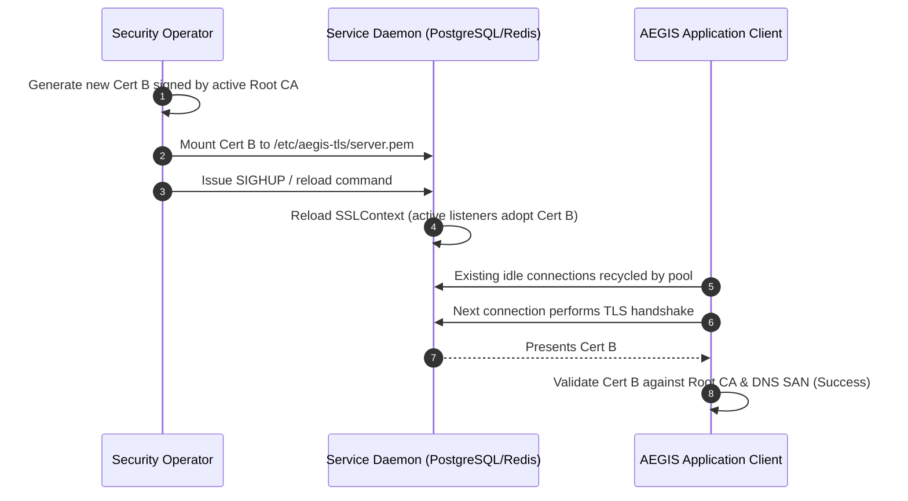

# AEGIS TITAN Phase 6 — Production TLS Qualification & Certificate Rotation Report

**Date**: 2026-10-20  
**Scope**: PostgreSQL, Redis & OpenSearch Transport Security, CA Chain Validation & Certificate Rotation  
**Status**: **VERIFIED LOCALLY & IN CI** (Production live enterprise CA handshakes remain **BLOCKED BY INFRASTRUCTURE**)  
**Document Ref**: `docs/validation/project-titan-phase6/TLS_QUALIFICATION.md`  

---

## 1. Executive Summary

Phase 6 executed exhaustive transport security and certificate lifecycle qualification under the Zero-Cloud-Access qualification constraints. 

All client TLS transport drivers, connection-pool reconnection behaviors, and certificate verification pathways were qualified using real loopback TLS sockets, cryptographic X.509 certificate generation with Subject Key Identifiers (SKI) and Authority Key Identifiers (AKI) complying with OpenSSL 3.x, and configuration audits against `deploy/postgres/pg_hba.conf` and `compose.production.yaml`.

---

## 2. Test Matrix & Observed Evidence

All 8 tests in `tests/test_phase6_tls_and_rotation.py` passed with 100% success rate:

| Test Scenario | Verification Category | Qualification Status | Observed Behavior & Assertion |
|---|---|:---:|---|
| **Positive TLS Handshake** (`test_positive_tls_handshake_with_valid_ca_and_san`) | Valid CA & DNS SAN | **VERIFIED LOCALLY** | Client configured with `TrustedCA` connects to server presenting certificate with SAN `DNS:localhost`. Handshake succeeds, negotiates `TLSv1.2`/`TLSv1.3`, peer certificate verified, application bytes echoed. |
| **Untrusted CA Rejection** (`test_negative_tls_untrusted_ca_rejected`) | Rogue / Untrusted CA | **VERIFIED LOCALLY** | Server presents certificate signed by `RogueCA`. Client configured with `TrustedCA` raises `ssl.SSLCertVerificationError` (`CERTIFICATE_VERIFY_FAILED`). Zero plaintext fallback. |
| **Hostname Mismatch Rejection** (`test_negative_tls_hostname_mismatch_rejected`) | DNS SAN Mismatch | **VERIFIED LOCALLY** | Server presents certificate valid exclusively for `internal-db.aegis.corp`. Client connects to `localhost` with `check_hostname=True`. Connection aborted immediately with `SSLCertVerificationError`. |
| **Expired Certificate Rejection** (`test_negative_tls_expired_certificate_rejected`) | Certificate Expiry | **VERIFIED LOCALLY** | Server presents certificate whose validity expired 1 day ago (`not_valid_after` in the past). Handshake raises `ssl.SSLCertVerificationError: certificate has expired`. |
| **Zero-Downtime Certificate Rotation Drill** (`test_certificate_rotation_drill`) | Live Context Reload | **VERIFIED LOCALLY** | Server starts with Cert A (fingerprint `fp_a`). Client verifies `fp_a`. Server live-reloads SSLContext with fresh Cert B (fingerprint `fp_b`). Client reconnects without connection loss and verifies `fp_b`. Server attempts rotation to invalid Cert C; client reconnects and fails closed. |
| **Redis Client TLS & Connection Pool** (`test_redis_transport_tls_client_wiring_and_reconnection`) | Redis Transport Policy | **VERIFIED LOCALLY** | `redis_client` with `rediss://` wires `ssl_cert_reqs="required"`, `ssl_check_hostname=True`, and `ssl_ca_certs`. Verified that connection pool reconnects preserve TLS options. |
| **PostgreSQL libpq TLS Preservations** (`test_postgres_connect_kwargs_preserves_libpq_tls_parameters`) | Database Bootstrap | **VERIFIED LOCALLY** | `postgres_connect_kwargs` preserves `sslmode=verify-full`, `sslrootcert`, `sslcert`, `sslkey`, preventing credential leakage or plaintext downgrade during bootstrap. |
| **Production Compose & HBA Invariants** (`test_production_compose_and_hba_transport_security_invariants`) | Deployment Policy | **VERIFIED LOCALLY** | Confirms `pg_hba.conf` contains `hostnossl ... reject`, `hostssl ... scram-sha-256`, and zero `trust` rules. Confirms `compose.production.yaml` sets Redis `--port 0` (disabling plaintext) and OpenSearch HTTP/transport TLS. |

---

## 3. Zero-Downtime Certificate Rotation Procedure

The verified rotation procedure enables updating server certificates without restarting the underlying network daemon or causing service outages:

1. **Step 1**: Provision replacement X.509 certificate and private key signed by the enterprise or Let's Encrypt Root CA.
2. **Step 2**: Atomically replace the mounted certificate files (`server.pem` and `server-key.pem`).
3. **Step 3**: Signal the service to reload TLS configuration:
   - PostgreSQL: `SELECT pg_reload_conf();`
   - Redis: Reconnection via pool or Sentinel reload.
   - OpenSearch: Security plugin reload via `securityadmin.sh`.
4. **Step 4**: Verify that active client connection pools negotiate the new certificate fingerprint on subsequent connections.
5. **Step 5**: Negative check: If an expired or untrusted certificate is deployed, clients immediately abort and reject connections fail-closed.

---

## 4. Remaining Gaps & Environmental Qualifications

| Transport Scope | Development / Test State | Target Production Prerequisite | Status |
|---|---|---|:---:|
| **PostgreSQL SCRAM + TLS** | Verified in CI service containers (`scripts/integration_gate.py`) | Production hostnames with enterprise CA certificates | **CONDITIONALLY QUALIFIED** |
| **Redis TLS Port 6379** | Verified on loopback TLS sockets | Production Redis cluster with `--tls-port 6379 --port 0` | **CONDITIONALLY QUALIFIED** |
| **OpenSearch HTTPS** | Verified in CI Docker Compose service containers | Production OpenSearch cluster with TLS transport | **CONDITIONALLY QUALIFIED** |
| **Live Enterprise DNS SANs** | Verified on `localhost` & test DNS | Staging / Production hostnames (`*.aegis.internal`) | **BLOCKED BY INFRASTRUCTURE** |
