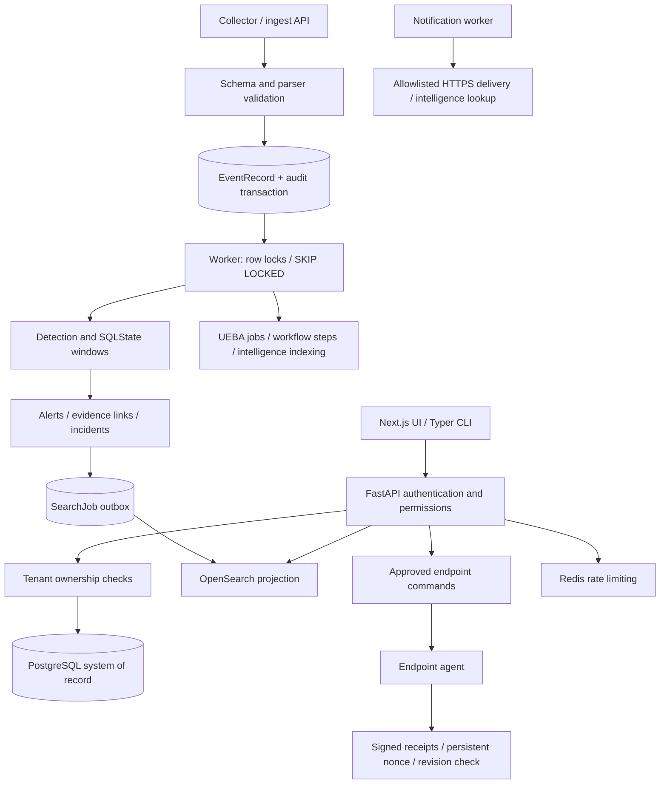

# PROJECT TITAN architecture audit

Date: 2026-10-18. Branch: `feature/ironclad-qualification`. HEAD: `33a5ea90a964e206fa63326322e46d296ae2efb1`.
This is an implementation-author audit, not independent verification. Static inspection and test execution are distinguished below. Repository baseline: 13 modified tracked files plus the untracked paths recorded in `initial-status.txt`. Existing IRONCLAD reports were read, not overwritten. No commit, push, merge, rebase, tag, or destructive Git operation was performed.

## Actual flows

Redis is not the primary event queue. `tests/test_integration.py::test_real_redis_queue_semantics_and_delivery` constructs a separate queue demonstration; it is not proof of AEGIS ingestion durability.

## Subsystem inventory (static inspection unless noted)

| Subsystem / entry | Core implementation and persistent state | Authorization boundary | Failure behavior / tests | Unverified assumptions |
|---|---|---|---|---|
| API / login / session / API keys | `aegis/api.py:create_app`, `security.py:authenticate,require`; User, SessionToken, APIKey | Server role permissions, API-key intersection, agent-specific permissions, cookie CSRF and Origin checks; organization derived from principal | Sanitized generic 503 handler; bounded body middleware; `test_security.py`, `test_audit_and_mfa.py`, `test_hardening.py` | Exhaustive route-by-route proof and deployment proxy/Host policy remain independent verification work |
| Events / collectors / syslog | `api.py:/events/ingest`, `collector.py`, `syslog.py`, `parsers.py`, `pipeline.py:ingest`; EventRecord, Collector | Ingest permission and principal tenant; deterministic event identity and raw-evidence digest | Reject oversized batches/events, conflicting source sequences, backlog overflow; `test_pipeline.py`, `test_collector.py`, `test_syslog.py`, `test_durability_and_backpressure.py` | Concurrent backlog count is not a strict capacity reservation; syslog transport deployment not exercised |
| Detection / worker | `worker.py:process_once`, `pipeline.py:detect_batch`, `detection.py:SQLState,evaluate`; WindowState, Rule, Alert, AlertEvent, Incident | Batch grouped by stored organization; namespaced windows | PostgreSQL row locks, savepoints, bounded attempts/exponential delay, DEAD state; `test_detection.py`, `test_concurrency_hardening.py`, `test_postgres_integration.py` | SQLite cannot prove PostgreSQL locking, deadlock recovery or multiprocess behavior |
| Search | `worker.py:project_once`, `storage.py:OpenSearchStorage,LocalStorage`; SearchJob, OpenSearch index | Organization filters injected by backend | Separate outbox transaction, stable document identity, retries/DEAD; local scan capped at 50,000; `test_opensearch_hardening.py`, `test_acceptance_recovery.py` | Live TLS, outage recovery, mapping behavior, throughput not executed |
| Rule lifecycle / MITRE / replay | `api.py` rules and replay routes, `replay.py:execute_replay`, `rules.py`, `sigma.py`; RuleVersion, ReplayJob, ReplayMatch | Rules permissions and tenant-owned rule/version/events | Validation and bounded replay max_events; `test_detection_lab.py` | Large replay latency and concurrent activation need live gate |
| Storylines | `api.py` storyline routes, `storylines.py:correlate,detail`; Storyline, StorylineMember, Incident | Principal tenant and owned resources | Bounded alert input, locking; `test_storylines.py` | Multi-session PostgreSQL result needs reproduction |
| Cases / incidents / evidence / exports | `api.py`, `investigation.py:owned,investigate`; Case, CaseNote, CaseEvidence, IncidentAlert, Report | Explicit ownership plus evidence permissions; PostgreSQL tenant triggers add defense | Relationship validation, revision/state checks, HTML/CSV handling; `test_master_qa_security_and_functional.py`, `test_cerberus.py`, `test_adversarial_verification.py` | SQLite schema creation omits PostgreSQL trigger enforcement; raw DB credential compromise is outside API tenant boundary |
| UEBA | `ueba_api.py`, `ueba.py:process_jobs`; BehaviorJob/Profile/Finding/Evidence | Role checks, ownership, tenant lock | Deterministic UTC-day analysis, event budget, synthetic-tag exclusion; `test_ueba.py`, `test_ueba_live.py` | Real service-backed findings and baseline quality not established by synthetic fixtures |
| IOC / intelligence | `intel_api.py`, `intelligence.py`, `intel_providers.py`; IOC, Observable, Enrichment, history | iocs permissions and tenant-owned references | Cached bounded queued lookups; explicit mock provider; fixed VirusTotal endpoint through allowlisted pinned-DNS transport; `test_intelligence.py` | External provider correctness/availability not exercised |
| SOAR workflows | `soar_api.py`, `soar.py:enqueue,advance,process_workflows`; Playbook/Version, WorkflowRun | Tenant lock, reference checks, requester reauthorization, independent approval decisions | One step/transaction; bounded retries and deadline; local containment simulated; `test_soar.py` | Timeout is checked after synchronous adapter returns, not hard cancellation; future external adapters need idempotent effect reconciliation |
| Legacy response / endpoint | `response.py`, `api.py` agent and playbook routes, `agent.py`; PlaybookExecution, Agent, enrollment tokens, nonce WindowState | Approval, enrolled key, agent identity, tenant, command and newly added target binding | Ed25519, freshness, durable nonce, conditional revision; `test_agent_security.py`, `test_agent_nonce_replay_invariant.py`, new TITAN tests | Simulation is mislabeled as enforcement; live firewall behavior unsafe (F-003/F-004); rotation/revocation race and multiworker receipts need PostgreSQL proof |
| Audit | `security.py:audit,verify_audit`, `audit_anchor.py`; AuditLog, AuditHead, AuditCheckpoint, org head | Tenant-specific chain; API permissions; runtime DB role restricts log UPDATE/DELETE | Head lock, HMAC and row-count/head verification, chain traversal; `test_audit_correctness.py`, `test_audit_anchors.py` | Independent anchor storage protection and coherent live verification during concurrent writes not proven |
| Notifications / integrations | `notification_worker.py`, `integrations.py`; Notification, Delivery, Integration | Role checks, tenant references, operator host allowlist and secret references | TLS, resolved IP pinning, redirect rejection, byte/time budgets, retry records; `test_integrations.py` | External delivery has at-least-once effects; receiver deduplication and live outage behavior need qualification |
| DB / migrations / retention | `db.py:database`, `migrations/versions/0001..0011`, `scripts/initialize.py`, `retention.py` | Runtime/maintenance roles, tenant triggers and constraints; guarded test URLs | Pool pre-ping; SQLite FK setup; production migration in initializer, not API startup; destructive downgrades refused; `test_migrations.py`, `test_retention.py`, `test_database_safety.py` | Fresh and previous-version PostgreSQL upgrades, restricted-role operation, encrypted restore not run |
| Frontend / CLI | `web/app`, `web/components`, `web/tests`, `aegis/cli.py:call` | HTTP API enforces permissions; CLI bearer token; local bootstrap commands trust operator DB credentials | 27 frontend tests and build executed; CLI transport fixed timeout/no redirects | Browser E2E and live UI behavior not run |
| Deploy / CI / operations | Compose, Dockerfiles, `.github/workflows/ci.yml`, `scripts/integration_gate.py`, `docs/operations` | Non-root application image, capability drop/read-only application root; operator manages credentials | CI defines Python/frontend checks, Compose drills, Trivy, CycloneDX SBOM upload, gitleaks | Clean-checkout run not performed; local Python 3.14.3 differs from CI 3.12; production PG/Redis TLS absent; SBOM retention period not explicitly set |

## Guarantees and limits

Ingestion acknowledges database persistence, with at-least-once processing. Detection effects are transactional; search projection is eventually consistent and independently retried. No exactly-once external-action guarantee is established. Out-of-budget late events raise from SQLState and can exhaust worker retries into DEAD. Event timestamp drives correlation; processing time drives retry availability and state expiry.

Audit threat model: HMAC protects against undetected modification by an attacker lacking the secret, assuming trusted heads/checkpoints. An attacker controlling both DB and keys can rewrite history. Database-local heads are not an independent trust root. Local-WORM adapter tests are not evidence of an independently protected remote checkpoint. Verification loads the full tenant chain, so large-history memory/time and consistent concurrent snapshots require measurement.

Performance inspection: event and search batches hold DB locks; search network calls occur inside the projection transaction; per-event collector upserts and tenant/audit serialization can contend; UEBA has explicit bounded windows; tenant backlog counts and full audit verification grow with history. No throughput, percentile latency, RPO or RTO claim is made. Existing documented targets remain unqualified.
