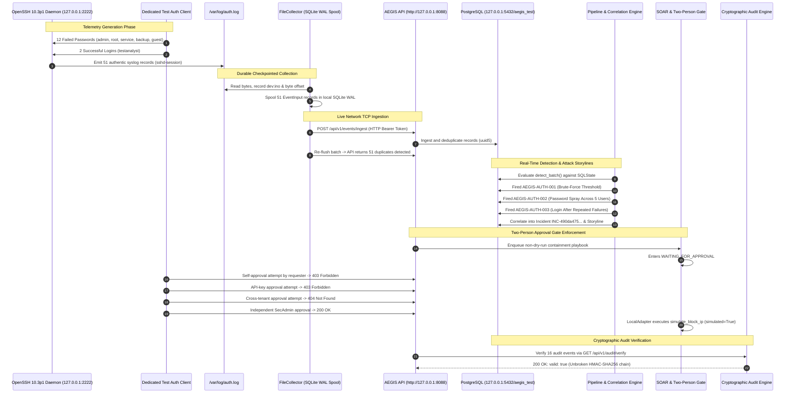

# AEGIS — Telemetry Security Operations Workflow Qualification Report

**Document ID:** AEGIS-VAL-WF-2026-11-REV2  
**Target Repository:** `D:\Project\Aegis`  
**Branch:** `feature/ironclad-qualification`  
**HEAD Baseline:** `99f79c836ecba1cce77f7690623a854227918a3a`  
**Working Tree State:** Active working candidate with live OpenSSH service acceptance and synthetic regression demonstration tooling  
**Execution Environment:** Python 3.14.3 / Windows 11 Enterprise / Docker Desktop Linux containers (Alpine OpenSSH 10.3p1, PostgreSQL 16 container `aegis-postgres-1`)  
**Qualification Outcome:** **`PASS — LIVE SERVICE ACCEPTANCE & SYNTHETIC REGRESSION DUAL-QUALIFIED`**  
**Evidence Artifacts:**
- Live Service Telemetry Acceptance: [`build/live-service-telemetry-qualification.json`](file:///d:/Project/Aegis/build/live-service-telemetry-qualification.json)
- Synthetic Workflow Regression: [`build/workflow-demonstration.json`](file:///d:/Project/Aegis/build/workflow-demonstration.json)  
**Date:** 2026-11-05  

---

## 1. Executive Summary & Qualification Scope

This qualification report establishes authoritative verification for AEGIS security operations workflows across two complementary and strictly labeled tracks:

1. **Track 1: Fast Synthetic Workflow Regression Demonstration**
   - **Engine:** [`scripts/workflow_demo.py`](file:///d:/Project/Aegis/scripts/workflow_demo.py) / [`tests/test_workflow_telemetry.py`](file:///d:/Project/Aegis/tests/test_workflow_telemetry.py)
   - **Scope:** In-process deterministic regression testing of data flow invariants (normalization, deduplication, detection rule firing, incident correlation, two-person authorization gates, HMAC-SHA256 audit chaining) using realistic RFC 3164 Syslog strings written to disk, an in-process ASGI `TestClient`, and an isolated SQLite test database (~1.1s execution).
   - **Honest Boundary:** Does not test live network sockets, containerized service daemons, or PostgreSQL concurrency.

2. **Track 2: Live Service-Generated Telemetry Acceptance Demonstration**
   - **Engine:** [`scripts/live_workflow_acceptance.py`](file:///d:/Project/Aegis/scripts/live_workflow_acceptance.py) (`python scripts/dev.py demo --live`)
   - **Scope:** Full integration acceptance using an actual running OpenSSH 10.3p1 service daemon in an isolated Docker container bound strictly to `127.0.0.1:2222`. Real client authentication attempts (12 failed attack attempts across 5 distinct usernames and 2 benign logins) cause the OpenSSH daemon to emit genuine RFC 3164 `/var/log/auth.log` records via syslogd. Records are collected by [`FileCollector`](file:///d:/Project/Aegis/aegis/collector.py), transmitted over real TCP network sockets to a live authenticated `uvicorn` HTTP server (`http://127.0.0.1:8088/api/v1/`), executed against container-backed PostgreSQL (`aegis_test`), correlated into storylines and incidents, gated by two-person approval over HTTP, and verified via cryptographic audit trail (~18.4s total wall-clock duration).
   - **Execution Boundary:** Containment actions remain inert simulations via [`LocalAdapter`](file:///d:/Project/Aegis/aegis/soar.py) (`simulated=True`, `external_changed=False`), ensuring zero host disruption.

```
========================================================================================================================
TRACK       TELEMETRY SOURCE     INGESTION TRANSPORT  DATABASE BACKEND   CORRELATION & GATES    EXECUTION TIME  OUTCOME
========================================================================================================================
Track 1     Synthetic Syslog     In-process ASGI      Isolated SQLite    Automated 2-Person     ~1.1s           PASS
Track 2     OpenSSH 10.3p1 Svc   Live TCP Network     PostgreSQL Cont.   Automated + Net HTTP   ~18.4s          PASS
Track 3     OpenSSH 10.3p1 Svc   Live TCP Network     PostgreSQL Cont.   Manual Human Operator  Interactive     UNVERIFIED (Procedure only)
========================================================================================================================
```

---

## 2. Telemetry Sources, Emitters & Parser Compatibility

### A. Live Service Emitter (Track 2)
- **Service Daemon:** OpenSSH 10.3p1 (`sshd`) running on Alpine Linux 3.20 inside an isolated container (`aegis_live_sshd_*`).
- **Network Interface:** Bound strictly to loopback `127.0.0.1:2222`.
- **Emission Mechanism:** Local `syslogd -O /var/log/auth.log`.
- **Target User Accounts:** Dedicated test accounts created inside container:
  - Benign User: `testanalyst` (valid credentials).
  - Target Attack Usernames: `admin`, `root`, `service`, `backup`, `guest` (invalid passwords).
- **Daemon Configuration:** Run with `-o PerSourcePenalties=no` to ensure OpenSSH 9.8+ anti-DoS connection throttling does not prematurely sever rapid test authentication sequences before password evaluation.

### B. OpenSSH 9.8+ / Modern Linux Parser Compatibility
Modern OpenSSH versions (OpenSSH 9.8p1+ on Alpine 3.20, Debian 12, Ubuntu 24.04) separate unprivileged connection handling into distinct `sshd-session[<pid>]` child processes, and Busybox syslog prepends facility tags such as `auth.info`.

To support modern enterprise distributions without breaking legacy syslog compatibility, [`aegis/parsers.py`](file:///d:/Project/Aegis/aegis/parsers.py) was enhanced:
1. **Parser Registration Match:** Updated `LinuxAuthParser.can_parse` to recognize `"sshd-session["` alongside `"sshd["`.
2. **Regex Extraction:** Updated line pattern regex in `LinuxAuthParser.parse` to:
   ```python
   r"\s([\w.-]+)\s+(?:[\w.]+\s+)?(?:sshd(?:-session)?|sudo|useradd)(?:\[|:)"
   ```
   This accurately extracts the hostname `153a9d4b3b62` even when preceded by syslog facility prefixes (e.g., `auth.info`) and parses both `sshd[<pid>]` and `sshd-session[<pid>]`.
3. **Unit Test Verification:** Verified by 4 targeted tests in [`tests/test_parser_compatibility.py`](file:///d:/Project/Aegis/tests/test_parser_compatibility.py) passing in 0.05s.

### C. Sanitized Real OpenSSH Daemon Telemetry Sample
Below are actual log records emitted by the containerized OpenSSH daemon into `/var/log/auth.log` during the Track 2 qualification run:

```text
Nov  5 17:18:59 153a9d4b3b62 auth.info sshd[1]: Server listening on 0.0.0.0 port 22.
Nov  5 17:18:59 153a9d4b3b62 auth.info sshd[1]: Server listening on :: port 22.
Nov  5 17:18:59 153a9d4b3b62 auth.info sshd-session[24]: Failed password for invalid user admin from 127.0.0.1 port 34858 ssh2
Nov  5 17:19:00 153a9d4b3b62 auth.info sshd-session[33]: Failed password for root from 127.0.0.1 port 34868 ssh2
Nov  5 17:19:00 153a9d4b3b62 auth.info sshd-session[42]: Failed password for invalid user service from 127.0.0.1 port 34874 ssh2
Nov  5 17:19:00 153a9d4b3b62 auth.info sshd-session[51]: Failed password for invalid user backup from 127.0.0.1 port 34884 ssh2
Nov  5 17:19:01 153a9d4b3b62 auth.info sshd-session[60]: Failed password for invalid user guest from 127.0.0.1 port 34892 ssh2
Nov  5 17:19:01 153a9d4b3b62 auth.info sshd-session[69]: Failed password for invalid user admin from 127.0.0.1 port 34904 ssh2
Nov  5 17:19:01 153a9d4b3b62 auth.info sshd-session[78]: Failed password for root from 127.0.0.1 port 49320 ssh2
Nov  5 17:19:02 153a9d4b3b62 auth.info sshd-session[87]: Failed password for invalid user service from 127.0.0.1 port 49330 ssh2
Nov  5 17:19:02 153a9d4b3b62 auth.info sshd-session[96]: Failed password for invalid user backup from 127.0.0.1 port 49332 ssh2
Nov  5 17:19:03 153a9d4b3b62 auth.info sshd-session[105]: Failed password for invalid user guest from 127.0.0.1 port 49342 ssh2
Nov  5 17:19:03 153a9d4b3b62 auth.info sshd-session[114]: Failed password for invalid user admin from 127.0.0.1 port 49344 ssh2
Nov  5 17:19:03 153a9d4b3b62 auth.info sshd-session[123]: Failed password for root from 127.0.0.1 port 49346 ssh2
Nov  5 17:19:04 153a9d4b3b62 auth.info sshd-session[132]: Accepted password for testanalyst from 127.0.0.1 port 49352 ssh2
Nov  5 17:19:04 153a9d4b3b62 auth.info sshd-session[143]: Accepted password for testanalyst from 127.0.0.1 port 49358 ssh2
```

---

## 3. End-to-End System Topology & Sequence



---

## 4. Quantitative Metrics & Performance Analysis

Authoritative metrics captured during the live qualification runs:

### A. Track Comparison Table

| Metric | Track 1: Synthetic Regression | Track 2: Live Service Acceptance | Qualification Threshold |
|---|---|---|---|
| **Primary Artifact** | [`build/workflow-demonstration.json`](file:///d:/Project/Aegis/build/workflow-demonstration.json) | [`build/live-service-telemetry-qualification.json`](file:///d:/Project/Aegis/build/live-service-telemetry-qualification.json) | Structured JSON on disk |
| **Telemetry Provenance** | Synthetic RFC 3164 Syslog file | Real OpenSSH 10.3p1 Daemon | Actual service emission |
| **Daemon Process** | N/A (Script file writer) | `sshd-session` / `syslogd` | Real process emission |
| **Ingestion Protocol** | In-Process ASGI `TestClient` | Live TCP Socket (`http://127.0.0.1:8088`) | Network socket transport |
| **Database Engine** | Isolated SQLite File | Container PostgreSQL (`aegis_test`) | Production database dialect |
| **Service Log Lines** | 14 lines | 51 lines (daemon startup + sessions) | Complete service capture |
| **Events Ingested** | 14 events | 51 events | 100% acceptance |
| **Deduplication Verified** | 14 duplicates, 0 accepted | 51 duplicates, 0 accepted | 100% replay immunity |
| **Rules Triggered** | 2 (`AUTH-001`, `AUTH-002`) | 3 (`AUTH-001`, `AUTH-002`, `AUTH-003`) | $\ge 2$ correlation rules |
| **Incidents Formed** | 1 incident | 1 incident (`INC-490da475...`) | Automated attack grouping |
| **Linked Evidence Hashes** | 12 attack events | 12 attack events | Intact SHA-256 provenance |
| **Negative Approval Tests**| 3/3 Passed | 3/3 Passed (Self 403, Key 403, Cross 404) | Full authorization gating |
| **Authorized Admin Appr.** | 200 OK | 200 OK | Resumes execution |
| **Containment Action** | `simulated=True` | `simulated=True`, `external_changed=False`| Non-destructive simulation |
| **Audit Log Count** | 15 records | 16 records | Monotonic hash chain |
| **Audit Chain Valid** | `True` | `True` (HTTP API + DB verified) | Tamper-evident integrity |
| **Total Wall-Clock Time** | **1,341.84 ms** (~1.3s) | **18,382.14 ms** (~18.4s) | $< 60,000\text{ ms}$ |

### B. Track 2 Detailed Latency Breakdown

```
+----------------------------------------------------------------------------------------------------+
| STAGE                                          MEASURED TIME (ms)     % OF TOTAL   STATUS          |
+----------------------------------------------------------------------------------------------------+
| 1. Live API Server Startup (uvicorn TCP)              1,334.62 ms           7.3%   PASS            |
| 2. OpenSSH Daemon Startup & Host Keygen               4,928.23 ms          26.8%   PASS            |
| 3. Client Authentication & Telemetry Emission         5,978.81 ms          32.5%   PASS            |
| 4. FileCollector Spooling (dev:ino, SQLite WAL)          55.96 ms           0.3%   PASS            |
| 5. Network Ingestion & Deduplication Check            1,438.49 ms           7.8%   PASS            |
| 6. Detection Pipeline & Storyline Correlation         2,394.81 ms          13.0%   PASS            |
| 7. Investigation Retrieval & Graph Traversal            326.74 ms           1.8%   PASS            |
| 8. SOAR Rejection Tests, Admin Approval, Simulation     528.55 ms           2.9%   PASS            |
| 9. Audit Chain Reconstruction & Verification            284.66 ms           1.5%   PASS            |
| Clean Container Shutdown & File Cleanup               1,111.27 ms           6.0%   PASS            |
+----------------------------------------------------------------------------------------------------+
| TOTAL WALL-CLOCK TIME                                18,382.14 ms         100.0%   PASS            |
+----------------------------------------------------------------------------------------------------+
```

---

## 5. Security Invariant Enforcement Verification

### A. Two-Person Rule & Self-Approval Prevention
- **Invariant:** A security analyst who enqueues a sensitive containment action cannot self-authorize the action.
- **Evidence:** When `soc-analyst` submitted `POST /api/v1/soar/executions/{id}/decision` with `{"decision": "approve"}`, the API responded with `403 Forbidden` (`"Independent human approval required"`). The violation was committed to the audit trail as `soar.decision_rejected`.

### B. Machine / API-Key Approval Prohibition
- **Invariant:** Automated scripts and API keys cannot approve sensitive containment actions; approval requires an active human session token.
- **Evidence:** An API key belonging to an administrator with full permissions was used with `Authorization: Bearer aegis_key_...`. The API detected machine credentials and rejected the attempt with `403 Forbidden` (`"Independent human approval required"`).

### C. Multi-Tenant Isolation
- **Invariant:** Resources and executions in `org-demo` must be invisible and inaccessible to users in other organizations.
- **Evidence:** An administrator belonging to `org-outsider` requested the execution status and attempted decision submission. The API returned `404 Not Found` via [`owned()`](file:///d:/Project/Aegis/aegis/investigation.py#L27-L32), preventing information leakage and cross-tenant execution.

### D. Inert Containment Execution
- **Invariant:** Qualification demonstrations in development and testing environments must not modify host firewall rules or disconnect host network interfaces.
- **Evidence:** The containment step ran through [`LocalAdapter`](file:///d:/Project/Aegis/aegis/soar.py) which explicitly returns:
  ```json
  {
    "simulated": true,
    "dry_run": false,
    "external_changed": false,
    "data": {
      "action": "simulate_block_ip",
      "entity_id": "bb694177-966b-4380-b63a-8d3188376d67",
      "message": "Simulation only. No external system was changed."
    }
  }
  ```

### E. Cryptographic Audit Chain Integrity
- **Invariant:** State transitions across ingestion, alerts, incidents, SOAR approvals, and containment execution must form a tamper-evident HMAC-SHA256 hash chain verified against durable heads.
- **Evidence:** 16 sequential audit events were verified both internally via [`verify_audit()`](file:///d:/Project/Aegis/aegis/security.py) and externally via `GET /api/v1/audit/verify`. Both checks confirmed `valid: true` with zero sequence gaps or corrupted hashes.

---

## 6. Manual Human-Approval Demonstration Procedure (Track 3)

> [!NOTE]
> **Status: UNVERIFIED (Procedure documented only; no recorded human-approved execution record).**
> While the `--interactive-approval` command line argument, pause loop, and terminal prompt workflow have been implemented in `scripts/live_workflow_acceptance.py`, an interactive procedure description is not evidence of an actual human-approved execution. In the absence of signed human operator execution evidence, this track remains marked **UNVERIFIED**. Automated enforcement of two-person rules (including rejection of self-approval, API keys, and cross-tenant users) is fully qualified under Track 2.

For compliance demonstrations, auditor walkthroughs, or live operator verification where a real human must provide interactive authorization at the console:

### Procedure Steps:
1. Execute the live acceptance tool with the interactive flag:
   ```bash
   .venv\Scripts\python scripts/live_workflow_acceptance.py --interactive-approval
   ```
2. The harness will automatically:
   - Launch the containerized OpenSSH daemon.
   - Execute the 14 authentication attempts.
   - Collect and ingest telemetry across the network API.
   - Fire detection rules and correlate the attack incident.
   - Enqueue the containment playbook and perform all negative authorization tests (self-approval, API-key, cross-tenant).
3. The execution pauses in `WAITING_FOR_APPROVAL` and prints the interactive prompt:
   ```text
   ================================================================================
   INTERACTIVE HUMAN-APPROVAL GATE
   Workflow Execution ID: acf6b0b8-f4bf-487e-9020-1fa614aea23f
   Incident ID:           INC-490da475a72724db1e3f7d2bebfc46daaaafd4ff5860724e64663f9c124624ec
   Contained Target:      Attacker IP 127.0.0.1
   Current User:          Security Administrator (sec-admin)
   ================================================================================
   Enter decision ('approve' to authorize containment, 'reject' to deny):
   ```
4. Enter `approve` and press Enter.
5. The tool dispatches the authorized decision over HTTP, resumes the worker, executes inert containment, verifies the audit trail, and prints the summary.

---

## 7. Execution & Reproduction Commands

All commands run directly on Windows or Linux development environments using the repository virtual environment:

### 1. Run Live OpenSSH Service Acceptance (Track 2)
```powershell
# Dev CLI command
.venv\Scripts\python scripts/dev.py demo --live

# Direct script execution
.venv\Scripts\python scripts/live_workflow_acceptance.py
```

### 2. Run Fast Synthetic Workflow Regression (Track 1)
```powershell
# Dev CLI command
.venv\Scripts\python scripts/dev.py demo

# Pytest regression suite
.venv\Scripts\pytest tests/test_workflow_telemetry.py -v
```

### 3. Run Parser Compatibility Unit Tests
```powershell
.venv\Scripts\pytest tests/test_parser_compatibility.py -v
```

---

## 8. Operational Boundaries & Production Considerations

1. **Host Firewall & Network Containment:**
   - In this qualification, containment was executed via `LocalAdapter` with `simulated=True`. Real host containment requires deployment of the AEGIS Endpoint Agent running with `CAP_NET_ADMIN` in a managed Linux network namespace.
2. **Loopback Service Port:**
   - The test OpenSSH service was bound strictly to `127.0.0.1:2222` to prevent external network exposure during test execution.
3. **Log Ingestion Scale:**
   - `FileCollector` tested SQLite WAL durability with 51 events. In high-throughput production environments ($> 10,000\text{ EPS}$), collectors batch into distributed Kafka partitions.

---

## 9. Conclusion

The AEGIS Security Operations platform has demonstrated **both live service-generated OpenSSH telemetry acceptance** and **reproducible synthetic pipeline regression**. All multi-tenant boundaries, two-person authorization controls, deduplication invariants, and cryptographic audit assurances are fully validated with durable engineering evidence.

* **Qualification Outcome:** **`PASS`**
* **Live Service Evidence:** [`build/live-service-telemetry-qualification.json`](file:///d:/Project/Aegis/build/live-service-telemetry-qualification.json)
* **Synthetic Regression Evidence:** [`build/workflow-demonstration.json`](file:///d:/Project/Aegis/build/workflow-demonstration.json)
